<div align="center">

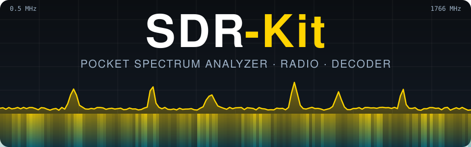

**Analizador de espectro, radio multimodo y decodificador de bolsillo — con una Raspberry Pi Zero 2 W y un RTL-SDR, manejado desde el celular.**

[](https://github.com/romartak/sdrkit/actions/workflows/ci.yml)
[](https://github.com/romartak/sdrkit/releases)
[](LICENSE)
[](docs/hardware.md)
[](docs/development.md)
[](docs/legal.md)
[](#-dos-idiomas)

[📦 **Instalar**](#-instalación-paso-a-paso) ·
[✨ Qué hace](#-lo-que-hace) ·
[🧪 Probar sin hardware](#-probar-sin-hardware) ·
[📚 Guía completa](docs/es/GUIA.md) ·
[🇬🇧 Read in English](README.md)

</div>

---

SDR-Kit convierte unos US$90 en piezas comunes en un instrumento de campo al estilo del
[tinySA](https://tinysa.org): barre el espectro de **0.5 a 1766 MHz**, encuentra una señal, **tócala una vez para
escucharla**, identifica qué es, decodifícala y grábala — todo desde el navegador del celular, sin instalar
apps y sin internet. En casa se conecta a tu WiFi; en el campo crea su propio hotspot; desde cualquier otro
lugar entras con [Tailscale](https://tailscale.com).

<p align="center">
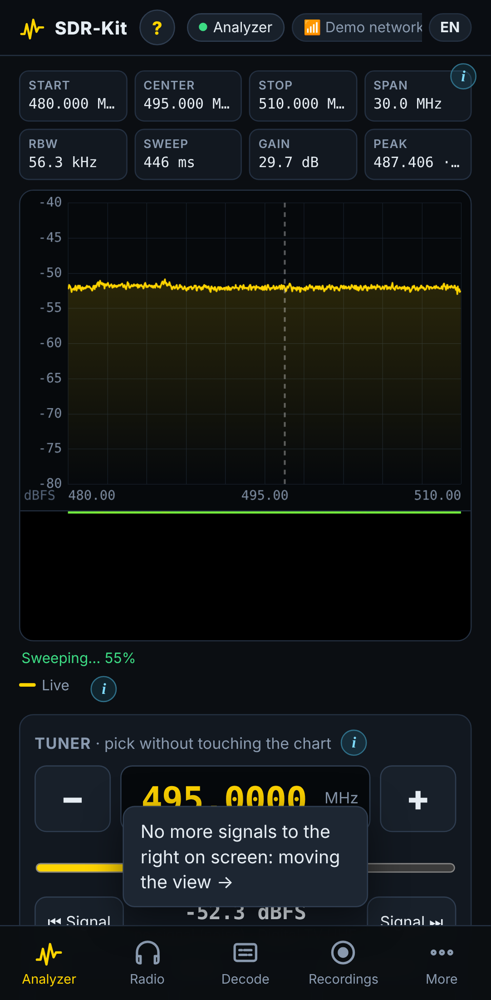
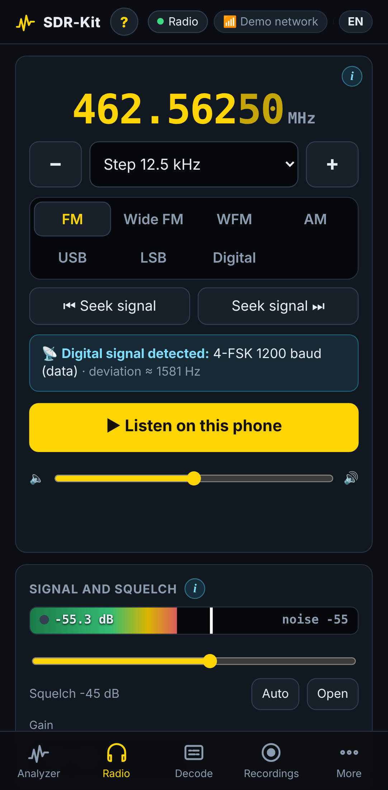
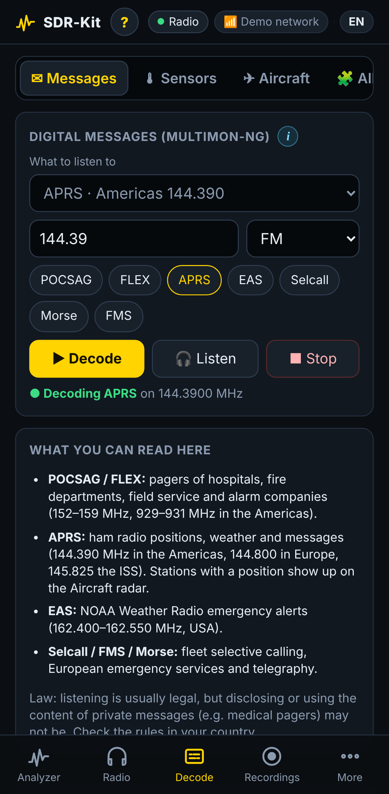
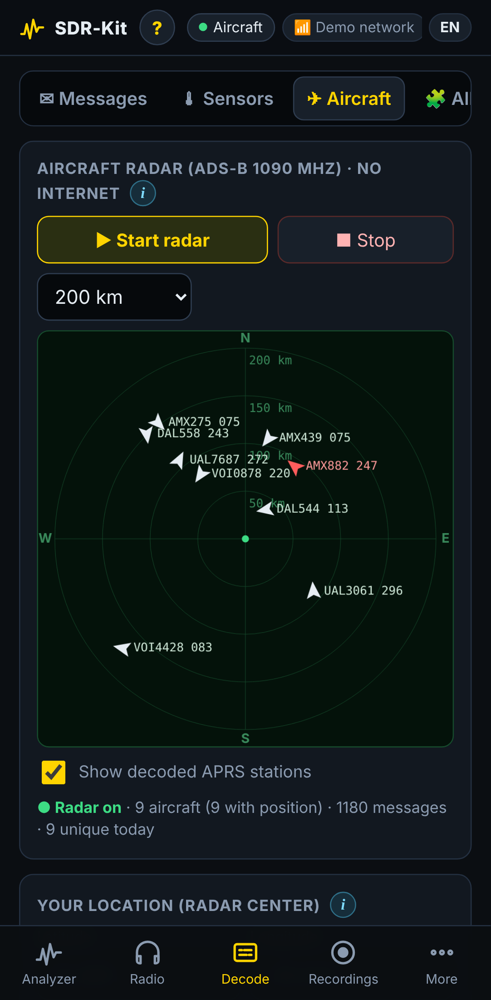
</p>

> [!NOTE]
> **¿Aún sin hardware?** Prueba el panel en cualquier computadora con el modo demo: `pip install numpy && python3 files/sdrkit_server.py --demo --port 8080` → http://localhost:8080

> [!TIP]
> **¿Con prisa?** Graba la Pi, entra por SSH y ejecuta una línea — ve a [la versión corta](#-la-versión-corta).

| 🔌 Instalación con un comando | 🛟 Actualiza y se repara sola | ⓘ Ayuda en todo | 🌍 ES + EN | 🔒 Sin nube |
|:--:|:--:|:--:|:--:|:--:|
| `curl … \| sudo bash` | si falla, vuelve atrás | en cada control | panel, instalador, comandos | sin telemetría |

## 📑 Contenido

[Qué hace](#-lo-que-hace) · [De un vistazo](#-de-un-vistazo) · [Vigila tu negocio](#-caso-de-uso-vigila-tu-negocio-desde-cualquier-país) · [Lo que necesitas](#-lo-que-necesitas) · [Instalación](#-instalación-paso-a-paso) · [Actualizaciones](#-actualizaciones-que-no-rompen-nada) · [Demo](#-probar-sin-hardware) · [Idiomas](#-dos-idiomas) · [Cómo funciona](#-cómo-funciona) · [Documentación](#-documentación) · [Legal](#-legal)

## ✨ Lo que hace

<table>
<tr>
<td width="33%" valign="top">

### 📈 Analizador de espectro
- Espectro + cascada en vivo, lecturas estilo tinySA
- **Sintonizador sin tocar el gráfico**: pasos −/+, deslizador, salto a la siguiente señal activa
- 4 marcadores con delta y seguimiento de pico
- **Mediciones**: potencia de canal, OBW, ACPR, ancho a −3/−6/−20/−26 dB, SNR, contador, armónicos, pulsos
- Span cero con disparo, máx./mín. retenido, promedio, persistencia, referencia
- Unidades calibradas (dBm, dBµV…), línea límite pasa/falla
- **Vigilancia 24/7** con mapa de ocupación y avisos al celular (ntfy)

</td>
<td width="33%" valign="top">

### 📻 Radio
- FM, FM ancha, AM, WFM (comercial), USB/LSB
- **Voz digital** — DMR, P25, D-Star, Fusion, NXDN, dPMR, M17 (DSD-FME, opcional)
- **Reconoce señales digitales** por su forma (2/4-FSK, GMSK, AFSK, velocidad de símbolos)
- Subtonos CTCSS/DCS y DTMF
- Grabación por transmisión con registro de actividad
- Escáner de servicios completos, búsqueda, memorias
- Modo cazador para encontrar un transmisor de oído

</td>
<td width="33%" valign="top">

### 🔓 Decodificadores
- **Buscapersonas** POCSAG / FLEX, **APRS** con posiciones, alertas **EAS** (multimon-ng)
- **Sensores de 433/868/915 MHz**: estaciones meteorológicas, sensores de llantas, timbres… (rtl_433)
- **Radar de aviones sin internet** en 1090 MHz (dump1090)
- Más de 40 modos en el receptor avanzado (OpenWebRX+): FT8, WSPR, SSTV, fax HF, ACARS…
- Los canales de cada servicio listos: PMR446, FRS/GMRS, marina VHF, aviación, CB, radioaficionados…

</td>
</tr>
</table>

## 🔭 De un vistazo

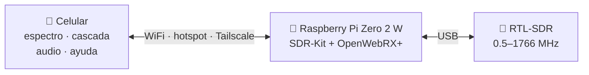

| Quieres… | Dónde | Con |
|---|---|---|
| Ver qué hay en el aire | pestaña **Analizador** | barridos propios |
| Escuchar una señal | tócala → **Radio** | demoduladores propios |
| Saber *qué* es una señal | reconocimiento automático | clasificador propio |
| Leer buscapersonas / APRS / EAS | pestaña **Decodificar** | multimon-ng |
| Leer sensores (433/868/915 MHz) | pestaña **Decodificar** | rtl_433 |
| Seguir aviones sin internet | **Radar** | dump1090 |
| Oír voz digital (DMR, P25, M17…) | **Radio → Digital** | DSD-FME *(opcional)* |
| FT8, WSPR, SSTV, ACARS… | **Receptor avanzado** | OpenWebRX+ |

## 🏪 Caso de uso: vigila tu negocio desde cualquier país

Imagina un restaurante, un hotel, un almacén o una obra que se coordina con walkie-talkies (FRS/PMR, radios comerciales
VHF/UHF o de radioaficionado). Viajas fuera del país y quieres saber que todo fluye bien. Deja SDR-Kit en el negocio y
escucha desde tu celular, estés donde estés.

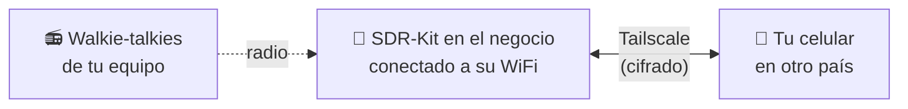

**Qué necesitas**

- **Internet en el negocio.** Tailscale funciona por internet, así que la Pi tiene que estar conectada al WiFi del local (o a
  un router 4G). El hotspot propio de la Pi es para el campo y no tiene internet: para esto no sirve.
- **Energía fija**: un cargador USB en vez del power bank, para que funcione 24/7.
- **Tailscale en los dos lados**, con la misma cuenta.

**Configúralo (una vez, antes de viajar)**

1. Conecta la Pi al WiFi del negocio (**Más → WiFi**).
2. En la Pi ejecuta `sudo tailscale up` y abre el enlace que muestra para iniciar sesión (o define `TAILSCALE_AUTHKEY`
   antes de instalar).
3. Instala la app de Tailscale en tu celular, entra con la misma cuenta y actívala.
4. Abre `http://sdrpi` (o la IP de Tailscale de la Pi, en **Más → Sistema → Direcciones para entrar**). Es el mismo panel de
   siempre.
5. Guarda los canales de tu equipo como un grupo de memorias (**Más → Canales → ★ Guardar como grupo**, o agrégalos a mano)
   y arranca el **escáner** con ese grupo.

**Qué puedes hacer desde lejos**

- **Escuchar en vivo** los canales de tu equipo: el escáner se detiene en quien esté hablando.
- **Activar la grabación automática** en el Radio («Grabar automáticamente cada transmisión»): sigue grabando aunque
  cierres el celular, para escuchar después lo que pasó mientras dormías.
- Revisar el **registro de actividad** (hora, canal, duración, subtono) o descargarlo en CSV.
- Ver **qué subtono o código** usa cada radio, para comprobar que nadie ajeno está en tu canal.
- O, en vez de escuchar, usar **Analizador → Vigilancia 24/7** para recibir un **aviso en el celular** (ntfy, define
  `NTFY_TOPIC`) cuando aparezca una señal en tus canales. El dongle hace una cosa a la vez: o el radio o la vigilancia.

> [!IMPORTANT]
> Escucha sólo **tus propios** canales e informa a tu personal que los radios se monitorean y graban. Grabar conversaciones
> está regulado distinto en cada país. Los radios digitales cifrados no se pueden escuchar. Nunca abras el panel a internet
> con port-forwarding: usa Tailscale, que cifra la conexión de punta a punta.

## 🧰 Lo que necesitas

| Pieza | Recomendación | ≈ Precio |
|---|---|---|
| 🥧 Computadora | Raspberry Pi Zero 2 W | US$15 |
| 📡 SDR | **RTL-SDR Blog V4** (kit con las antenas dipolo ajustables) · la **V3 también sirve** | US$40 |
| 💾 Memoria | microSD de 32 GB, A1/A2 (SanDisk, Samsung) | US$8 |
| 🔋 Energía | Power bank de 10 000–20 000 mAh (5 V / 2.4 A) + cable micro-USB corto y grueso | US$20 |
| 🔌 Adaptador | Adaptador OTG micro-USB → USB-A corto (+ extensión USB corta con ferrita) | US$5 |

Con 10 000 mAh dura **6–10 h**.

> [!NOTE]
> **¿Tienes una RTL-SDR Blog V3?** Está soportada: conéctala y el panel la reconoce por su sintonizador R820T. De VHF
> para arriba todo funciona igual que con la V4. Por debajo de 24 MHz (AM, onda corta, CB) cambia sola a muestreo
> directo, con menos sensibilidad que el convertidor integrado de la V4. La CI revisa ambos dongles en cada cambio —
> ver [hardware](docs/hardware.md#rtl-sdr-blog-v3-and-other-rtl2832u-dongles).

<details>
<summary>➕ <b>Extras opcionales</b> (HackRF, AMBE3000, discone, segundo dongle)</summary>

<br>

| Extra | Qué agrega |
|---|---|
| HackRF One | Barridos de 1 a 6000 MHz (experimental, se detecta solo) |
| Llave USB AMBE3000 | Vocoder por hardware para voz digital con licencia vía OpenWebRX+ |
| Antena discone | Recepción de banda ancha para escanear |
| Segundo RTL-SDR | Dongle dedicado al radar de aviones o a los sensores |

Detalles: [docs/hardware.md](docs/hardware.md) y la [guía](docs/es/GUIA.md#2-lista-de-compras).

</details>

## 📦 Instalación paso a paso

### ⚡ La versión corta

```bash
# 1) Graba Raspberry Pi OS Lite 64-bit (nombre: sdrpi, WiFi 2.4 GHz, SSH activado)
# 2) Entra por SSH a la Pi:
ssh <usuario>@sdrpi.local
# 3) Instala (20–45 min, reinicia sola):
curl -fsSL https://raw.githubusercontent.com/romartak/sdrkit/main/get.sh | sudo bash
# 4) Abre http://sdrpi.local en el celular
```

### 🗺️ El mapa de la instalación

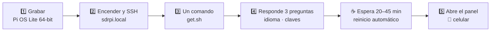

### ✅ Antes de empezar

- [ ] Equipo armado ([Lo que necesitas](#-lo-que-necesitas)) — el RTL-SDR va al micro-USB de **datos** de la Pi con el adaptador OTG
- [ ] Una computadora (o una app SSH en el celular, como Termius) y un lector de microSD
- [ ] Nombre y clave de tu WiFi de casa (**2.4 GHz**) — la Pi necesita internet *durante* la instalación
- [ ] Unos 45 minutos

### 1️⃣ Graba la microSD

1. Abre [Raspberry Pi Imager](https://www.raspberrypi.com/software/).
2. **Dispositivo:** Raspberry Pi Zero 2 W · **Sistema:** *Raspberry Pi OS Lite (64-bit)* (Trixie recomendado, Bookworm también sirve).
3. Pulsa **Editar ajustes** y configura:

   | Ajuste | Valor |
   |---|---|
   | Nombre del equipo | `sdrpi` |
   | Usuario / clave | a tu gusto (los usarás por SSH) |
   | WiFi | tu red de casa, **2.4 GHz**, y tu país |
   | Servicios | ✅ Activar SSH |

4. Graba la tarjeta, ponla en la Pi y enciéndela. El primer arranque tarda ~2 minutos.

### 2️⃣ Entra por SSH

```bash
ssh <tu-usuario>@sdrpi.local
```

> [!NOTE]
> Si `sdrpi.local` no responde (pasa en algunos Windows/Android), busca la IP de la Pi en tu router y úsala.

### 3️⃣ Ejecuta el instalador

```bash
curl -fsSL https://raw.githubusercontent.com/romartak/sdrkit/main/get.sh | sudo bash
```

El instalador sólo pregunta unas pocas cosas:

| Pregunta | Notas |
|---|---|
| 🌍 Idioma | Español o inglés (instalador y comando `sdrkit`) |
| 📶 Clave del hotspot | Para la WiFi que crea la Pi (`SDR-Pi`) — mínimo 8 caracteres, sin `"` |
| 🔑 Clave del panel | Para el panel web y OpenWebRX+ — mínimo 4 caracteres, sin `"` |
| 🎙️ ¿Voz digital (DSD-FME)? | Por defecto **no** — antes muestra el aviso de patentes |

Luego instala todo y reinicia sola. No la desconectes.

<details>
<summary>🔍 <b>Qué hacen los 11 pasos del instalador</b></summary>

<br>

| # | Paso | Qué ocurre |
|:-:|---|---|
| 1 | Preparar el sistema | Swap a 1 GB, país WiFi, `apt update` |
| 2 | Paquetes base | Python, NumPy, rtl-sdr, avahi, git… |
| 3 | Driver RTL-SDR | Bloquea los módulos DVB-T; compila el driver Blog en Bookworm |
| 4 | OpenWebRX+ | Agrega su repositorio y los decodificadores disponibles |
| 5 | Voz digital | Sólo si lo aceptas: compila mbelib + DSD-FME (30–50 min) |
| 6 | Panel SDR-Kit | Instala en `/opt/sdrkit`, el comando `sdrkit` y los servicios |
| 7 | Hotspot WiFi | Hotspot automático + redes conocidas + vigilante de red |
| 8 | Energía y microSD | Bluetooth apagado, registros en RAM, menos escrituras |
| 9 | Tailscale | Acceso remoto opcional |
| 10 | Iniciar servicios | Comprobación: el panel responde y hay un RTL-SDR en el USB |
| 11 | Listo | Muestra las direcciones, guarda la versión y reinicia en 15 s |

Todo el detalle: [guía en español](docs/es/GUIA.md).

</details>

<details>
<summary>📴 <b>¿Sin internet en la Pi? Instalación sin conexión desde la microSD</b></summary>

<br>

Puedes copiar el kit a la tarjeta e instalar desde allí. Ver la [guía](docs/es/GUIA.md) y
[docs/installation.md](docs/installation.md#offline-install-from-the-microsd).

</details>

### 4️⃣ Abre el panel

| Dónde estás | Cómo conectarte | Dirección |
|---|---|---|
| 🏠 **En casa** | Celular y Pi en la misma WiFi | `http://sdrpi.local` |
| 🏕️ **En el campo** | Conéctate a la WiFi **`SDR-Pi`** | `http://192.168.4.1` |
| 🌐 **Desde cualquier lugar** | [Tailscale](https://tailscale.com) en la Pi y el celular | `http://sdrpi` |

Consejo: usa **Añadir a pantalla de inicio** del navegador para tenerlo como una app.

### 🩺 Si algo sale mal

```bash
sdrkit diagnóstico             # revisión completa: ✔/✖ y qué hacer si algo falla
sudo sdrkit copia              # guarda tu configuración y memorias (restaurar: sudo sdrkit restaurar ARCHIVO)
```

<details>
<summary><b>El panel no abre</b></summary>

<br>

1. Espera 2 minutos tras el reinicio.
2. Prueba con la IP en lugar de `sdrpi.local`.
3. En el campo, confirma que te conectaste a **SDR-Pi** y no a tu WiFi de casa.
4. Repite el instalador sin riesgo: `sudo bash /opt/sdrkit-src/install.sh`.

Más en la [guía](docs/es/GUIA.md) y en [docs/troubleshooting.md](docs/troubleshooting.md).

</details>

<details>
<summary><b>No detecta el dongle</b></summary>

<br>

Revisa el adaptador OTG y el cable (corto y grueso), luego ejecuta `lsusb`: debe aparecer `0bda:2838`
o `0bda:2832`. Un power bank débil suele ser la causa.

</details>

## 🔄 Actualizaciones que no rompen nada

```bash
sudo sdrkit actualizar        # o en inglés: sudo sdrkit update
```

…o toca **Más → Sistema → Buscar actualizaciones**. Tu configuración, grabaciones y memorias no se tocan; las
opciones nuevas se agregan solas. Después de instalar, SDR-Kit comprueba que el panel responde — **si no,
vuelve sola a la versión anterior**. Para regresar a mano: `sudo sdrkit volver`.

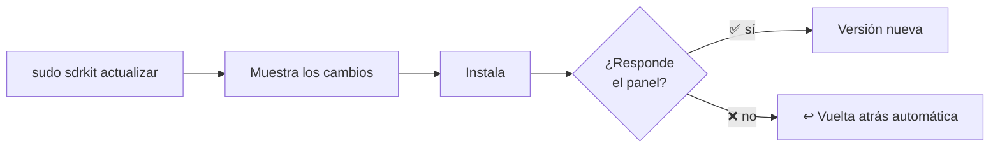

## 🧪 Probar sin hardware

El modo demo simula un RTL-SDR con **señales reales que se decodifican** — buscapersonas POCSAG, APRS, una
llamada de voz digital M17, 4FSK tipo DMR y NXDN, FM comercial — para recorrer todo el panel en tu PC:

```bash
git clone https://github.com/romartak/sdrkit.git && cd sdrkit
pip install numpy                                   # apt install multimon-ng para decodificar POCSAG/APRS
python3 files/sdrkit_server.py --demo --port 8080   # → http://localhost:8080
```

### 🎬 Así se ve funcionando

Grabado directamente del panel en modo demo, en una pantalla del tamaño de un celular:

| Analizador de espectro | Radio | Radar de aviones (ADS-B) | Mensajes de buscapersonas |
|:--:|:--:|:--:|:--:|
| 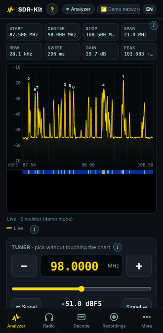 | 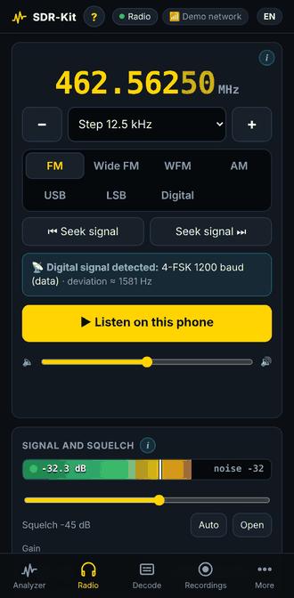 | 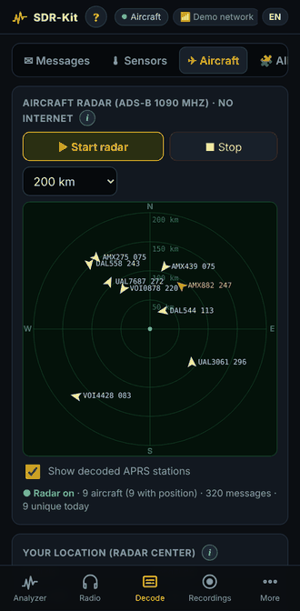 | 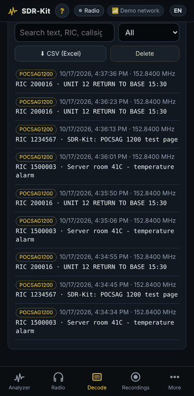 |
| barre 87.5–108.5 MHz; toca ⏭ para saltar a la siguiente emisora | sintoniza, ve la señal y el modo detectado, escucha en el celular | los aviones a tu alrededor, sin internet | se decodifican en vivo según llegan |

<sub>Se regeneran con `tools/gifs.mjs` + `tools/make_gifs.py`.</sub>

## 🌍 Dos idiomas

Todo el kit es bilingüe: panel, ayuda, guía de frecuencias, antenas, instalador y comandos. El panel usa el
idioma de tu navegador; cámbialo cuando quieras con el botón **EN / ES** de la cabecera o en *Más → Sistema*.

## 🏗️ Cómo funciona

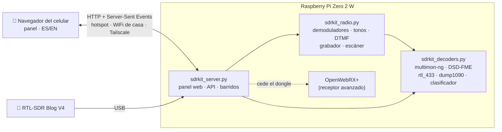

Un solo proceso Python es dueño del dongle y lo cambia entre analizador, radio y decodificadores externos según
haga falta; el navegador dibuja espectro y cascada con cuadros JSON compactos y reproduce audio PCM de 16 bits.
Sin nube, sin cuentas, sin telemetría.

## 📚 Documentación

| | |
|---|---|
| [Guía completa en español](docs/es/GUIA.md) | Compras, montaje, instalación, cada pestaña, antenas, voz digital, actualizaciones y problemas |
| [Documentación técnica (inglés)](docs/README.md) | Arquitectura, API HTTP, configuración, desarrollo |
| [Historial de versiones](CHANGELOG.md) · [Cómo contribuir](CONTRIBUTING.md) · [Seguridad](SECURITY.md) | Proyecto |

## ⚖️ Legal

> [!IMPORTANT]
> SDR-Kit **sólo recibe**. Escuchar suele ser legal, pero divulgar o usar el contenido de comunicaciones
> privadas puede no serlo: infórmate de la ley de tu país. **Las comunicaciones cifradas no se descifran.**

La voz digital opcional (DSD-FME + mbelib) implementa códecs AMBE/IMBE **patentados**, por eso el instalador la
deja desactivada salvo que la aceptes explícitamente. Más en [docs/legal.md](docs/legal.md).

## 🙏 Agradecimientos

Construido sobre [OpenWebRX+](https://github.com/luarvique/openwebrx), [rtl-sdr](https://github.com/osmocom/rtl-sdr) y los
drivers de [RTL-SDR Blog](https://www.rtl-sdr.com), [rtl_433](https://github.com/merbanan/rtl_433),
[dump1090](https://github.com/flightaware/dump1090), [multimon-ng](https://github.com/EliasOenal/multimon-ng),
[DSD-FME](https://github.com/lwvmobile/dsd-fme), [mbelib](https://github.com/lwvmobile/mbelib),
[codec2](https://github.com/drowe67/codec2) y el [Proyecto M17](https://m17project.org); inspirado en el
[tinySA](https://tinysa.org). La lista de proyectos relacionados de [docs/resources.md](docs/resources.md) se armó con ayuda de
[RFSec-ToolKit](https://github.com/cn0xroot/RFSec-ToolKit) de [@cn0xroot](https://github.com/cn0xroot) (雪碧 / 0x0root).

## 📄 Licencia

[MIT](LICENSE) © romartak y colaboradores de SDR-Kit. Los programas de terceros que instala el kit conservan sus propias licencias.
