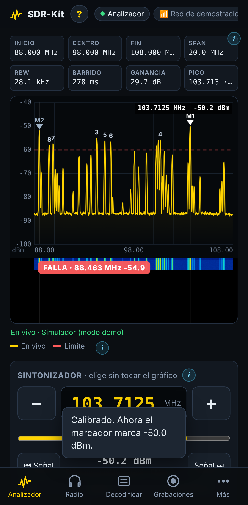
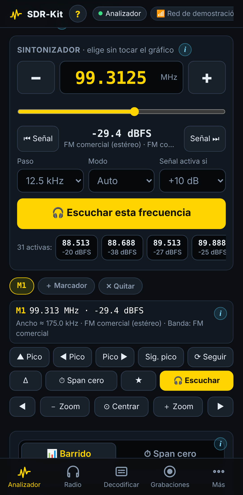
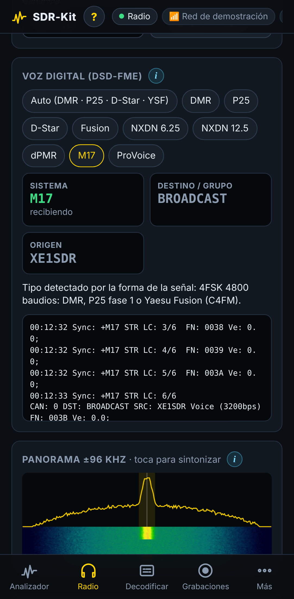
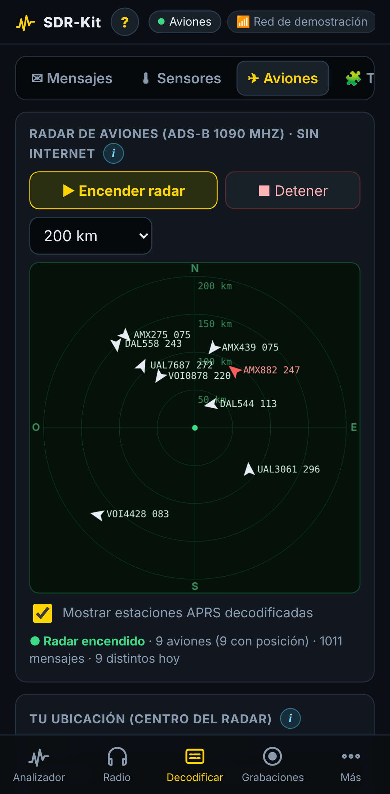

# SDR-Kit


Analizador de espectro estilo **tinySA**, radio y decodificador portátil con **Raspberry Pi Zero 2 W + RTL-SDR**, manejado desde el celular por WiFi.

| Analizador | Sintonizador | Voz digital | Aviones |
|---|---|---|---|
|  |  |  |  |

- **Analizador:**
  - Marcadores con delta.
  - Mediciones: potencia de canal, OBW, ACPR, ancho de banda, SNR y armónicos.
  - Span cero, persistencia y línea límite.
  - Vigilancia 24/7 con avisos al celular.
- **Sintonizador:** elige la frecuencia sin tocar el gráfico (−/+, deslizador, salto a la siguiente señal) y escúchala al instante.
- **Radio:**
  - FM, AM, WFM, SSB y **voz digital** (DMR, P25, D-Star, Fusion, NXDN, dPMR, M17).
  - Subtonos CTCSS/DCS y DTMF.
  - Grabación por transmisión y escáner de servicios completos.
- **Decodificar:** buscapersonas POCSAG/FLEX, APRS, alertas EAS, sensores de 433 MHz, radar de aviones sin internet. Más de 40 modos en OpenWebRX+.
- **Hotspot propio** en el campo, tu WiFi en casa y **Tailscale** para usarlo desde cualquier lugar.
- Botón **ⓘ** con explicación en cada parte del panel.

## Instalar (en la Raspberry, por SSH)

1. Graba **Raspberry Pi OS Lite (64-bit)** con Raspberry Pi Imager. Configura el nombre `sdrpi`, tu WiFi de casa (2.4 GHz) y activa SSH.
2. Conéctate por SSH y ejecuta:

```
curl -fsSL https://raw.githubusercontent.com/romartak/sdrkit/main/get.sh | sudo bash
```

El instalador pide la clave del hotspot y la del panel, instala todo (20–45 min) y reinicia. Luego abre `http://sdrpi.local` (en casa) o conéctate a la WiFi **SDR-Pi** y abre `http://192.168.4.1` (en el campo).

> ¿Sin internet en la Pi? Descarga el ZIP del repositorio, copia la carpeta a la partición `bootfs` de la microSD y ejecuta `sudo bash /boot/firmware/sdrkit/install.sh`.

## Actualizar

En casa, con la Raspberry conectada a internet, tienes dos caminos:

```
sudo sdrkit actualizar          # muestra los cambios y pregunta
```

O en el panel: **Más → Sistema → Buscar actualizaciones**.

- Tu configuración (`/etc/sdrkit/sdrkit.conf`), grabaciones y memorias **no se tocan**.
- Las opciones nuevas se agregan solas a tu configuración.
- Si la versión nueva no arranca, **vuelve sola a la anterior**. Para regresar a mano: `sudo sdrkit volver`.

| Comando | Para qué |
|---|---|
| `sdrkit actualizar --buscar` | Sólo avisa si hay algo nuevo |
| `sdrkit version` | Versión instalada |
| `sudo sdrkit config` | Editar la configuración |
| `sdrkit` | Todos los comandos |

## Mejorar el proyecto (flujo de trabajo)

1. Haz los cambios en tu computadora (o pídeselos a Claude).
2. Si cambias paquetes o pasos del sistema en `install.sh`, sube `INSTALL_REV`. La próxima actualización hará entonces la instalación completa en vez de sólo copiar el panel.
3. Sube `VERSION` y agrega una línea a `CHANGELOG.md`.
4. Súbelo a GitHub. La pestaña **Actions** prueba todo automáticamente: espera la ✔ verde.
5. En la Pi: `sudo sdrkit actualizar`.

**Para probar sin riesgo:**
1. Sube los cambios a una rama `pruebas`.
2. En la Pi pon `SDRKIT_BRANCH="pruebas"` (con `sudo sdrkit config`) y actualiza.
3. Para volver a la versión estable, deja la rama vacía y actualiza otra vez.

**Probar el panel en tu PC sin hardware:**

```
pip install numpy
python3 files/sdrkit_server.py --demo --port 8080
```

## Documentación

- [GUIA.md](GUIA.md): guía completa, con compras, montaje, uso, antenas, voz digital y problemas.
- [CHANGELOG.md](CHANGELOG.md): qué cambió en cada versión.

## Legal

- El RTL-SDR sólo recibe.
- Escuchar suele ser legal, pero divulgar comunicaciones privadas puede no serlo; infórmate en tu país.
- Las comunicaciones cifradas no se descifran.
- La voz digital en el panel usa DSD-FME + mbelib, que implementan códecs AMBE/IMBE **patentados**. Por eso el instalador lo deja opcional y muestra el aviso ([detalles](https://github.com/lwvmobile/mbelib#readme)).
