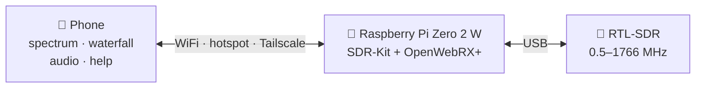
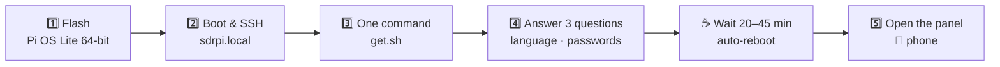
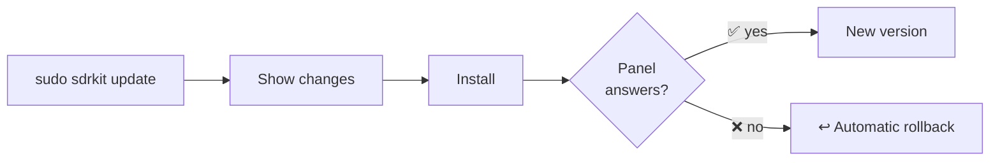
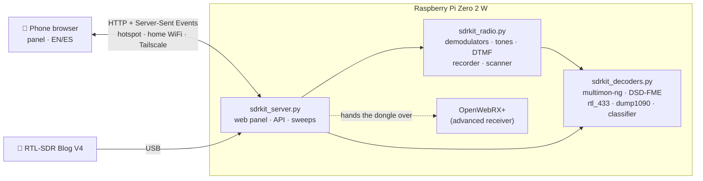

<div align="center">


**A pocket spectrum analyzer, multimode radio and signal decoder — built from a Raspberry Pi Zero 2 W and an RTL-SDR, used from your phone.**

[](https://github.com/romartak/sdrkit/actions/workflows/ci.yml)
[](https://github.com/romartak/sdrkit/releases)
[](LICENSE)
[](docs/hardware.md)
[](docs/development.md)
[](docs/legal.md)
[](#-two-languages)

[📦 **Install**](#-installation-step-by-step) ·
[✨ Features](#-highlights) ·
[🧪 Try without hardware](#-try-it-without-hardware) ·
[📚 Docs](docs/README.md) ·
[🇪🇸 Leer en español](README.es.md)

</div>

---

SDR-Kit turns ~US$90 of off-the-shelf parts into a field instrument in the spirit of the
[tinySA](https://tinysa.org): sweep the spectrum from **0.5 to 1766 MHz**, find a signal, **tap once to listen
to it**, identify what it is, decode it, record it — all from a phone browser, with no app to install and no
internet required. At home it joins your WiFi; in the field it creates its own hotspot; anywhere else it is one
[Tailscale](https://tailscale.com) hop away.

<p align="center">


</p>

> [!NOTE]
> **No hardware yet?** Try the panel on any computer with demo mode: `pip install numpy && python3 files/sdrkit_server.py --demo --port 8080` → http://localhost:8080

> [!TIP]
> **In a hurry?** Flash the Pi, SSH in and run one line — jump to [the 3-minute version](#-the-short-version).

| 🔌 One-command install | 🛟 Self-rollback updates | ⓘ Help everywhere | 🌍 EN + ES | 🔒 Offline & private |
|:--:|:--:|:--:|:--:|:--:|
| `curl … \| sudo bash` | breaks → restores itself | on every control | panel, installer, CLI | no cloud, no telemetry |

## 📑 Contents

[Highlights](#-highlights) · [At a glance](#-at-a-glance) · [Hardware](#-hardware) · [Installation](#-installation-step-by-step) · [Updates](#-updates-that-cannot-brick-your-kit) · [Demo](#-try-it-without-hardware) · [Languages](#-two-languages) · [How it works](#-how-it-works) · [Docs](#-documentation) · [Roadmap](#-roadmap) · [Contributing](#-contributing) · [Legal](#-legal)

## ✨ Highlights

<table>
<tr>
<td width="33%" valign="top">

### 📈 Spectrum analyzer
- Live spectrum + waterfall, tinySA-style readouts
- **Tuner without touching the graph**: −/+ steps, slider, jump to the next active signal
- 4 markers with delta and peak tracking
- **Measurements**: channel power, OBW, ACPR, −3/−6/−20/−26 dB bandwidth, SNR, counter, harmonics, pulses
- Zero span with trigger, max/min hold, average, persistence, reference
- Calibrated units (dBm, dBµV…), limit line with pass/fail
- **24/7 monitor** with occupancy map and phone alerts (ntfy)

</td>
<td width="33%" valign="top">

### 📻 Radio
- FM, wide FM, AM, WFM (broadcast), USB/LSB
- **Digital voice** — DMR, P25, D-Star, Fusion, NXDN, dPMR, M17 (DSD-FME, optional)
- **Automatic recognition** of digital signals by their shape (2/4-FSK, GMSK, AFSK, symbol rate)
- CTCSS/DCS tone squelch detection and DTMF
- Per-transmission recording with an activity log
- Scanner over whole services, seek, memories
- Fox-hunt mode to find a transmitter by ear

</td>
<td width="33%" valign="top">

### 🔓 Decoders
- **Pagers** POCSAG / FLEX, **APRS** with positions, **EAS** alerts (multimon-ng)
- **433/868/915 MHz sensors**: weather stations, tyre sensors, doorbells… (rtl_433)
- **Offline aircraft radar** on 1090 MHz (dump1090)
- 40+ more modes in the advanced receiver (OpenWebRX+): FT8, WSPR, SSTV, HF fax, ACARS…
- Every service's channel plan built in: PMR446, FRS/GMRS, marine VHF, airband, CB, ham bands…

</td>
</tr>
</table>

## 🔭 At a glance



| You want to… | Where | Powered by |
|---|---|---|
| See what is on the air | **Analyzer** tab | built-in sweeps |
| Listen to a signal | tap it → **Radio** | built-in demodulators |
| Know *what* a signal is | auto-recognition | built-in classifier |
| Read pagers / APRS / EAS | **Decode** tab | multimon-ng |
| Read sensors (433/868/915 MHz) | **Decode** tab | rtl_433 |
| Track aircraft offline | **Radar** | dump1090 |
| Hear digital voice (DMR, P25, M17…) | **Radio → Digital** | DSD-FME *(optional)* |
| FT8, WSPR, SSTV, ACARS… | **Advanced receiver** | OpenWebRX+ |

## 🧰 Hardware

| Part | Recommended | ≈ Price |
|---|---|---|
| 🥧 Computer | Raspberry Pi Zero 2 W | US$15 |
| 📡 SDR | **RTL-SDR Blog V4** (kit with the adjustable dipole antennas) | US$40 |
| 💾 Storage | 32 GB microSD, A1/A2 (SanDisk, Samsung) | US$8 |
| 🔋 Power | 10 000–20 000 mAh power bank (5 V / 2.4 A) + short, thick micro-USB cable | US$20 |
| 🔌 Adapter | Short micro-USB OTG → USB-A adapter (+ a short USB extension with ferrite) | US$5 |

Runtime is about **6–10 h** on a 10 000 mAh bank.

<details>
<summary>➕ <b>Optional extras</b> (HackRF, AMBE3000, discone, second dongle)</summary>

| Extra | What it adds |
|---|---|
| HackRF One | Sweeps from 1 to 6000 MHz (experimental, auto-detected) |
| AMBE3000 USB stick | Hardware vocoder for licensed digital voice via OpenWebRX+ |
| Discone antenna | Wideband reception for scanning |
| Second RTL-SDR | Dedicated dongle for aircraft radar or sensors |

Details and wiring: [docs/hardware.md](docs/hardware.md).

</details>

## 📦 Installation, step by step

### ⚡ The short version

```bash
# 1) Flash Raspberry Pi OS Lite 64-bit (hostname: sdrpi, WiFi 2.4 GHz, SSH on)
# 2) SSH into the Pi:
ssh <user>@sdrpi.local
# 3) Install (20–45 min, reboots by itself):
curl -fsSL https://raw.githubusercontent.com/romartak/sdrkit/main/get.sh | sudo bash
# 4) Open http://sdrpi.local on your phone
```

### 🗺️ The road map of the install



### ✅ Before you start

- [ ] Hardware assembled ([Hardware](#-hardware)) — RTL-SDR on the Pi's **data** micro-USB port via the OTG adapter
- [ ] A computer (or a phone SSH app such as Termius) and a microSD card reader
- [ ] Your home WiFi (**2.4 GHz**) name and password — the Pi needs internet *during* install
- [ ] About 45 minutes

### 1️⃣ Flash the microSD card

1. Open [Raspberry Pi Imager](https://www.raspberrypi.com/software/).
2. **Device:** Raspberry Pi Zero 2 W · **OS:** *Raspberry Pi OS Lite (64-bit)* (Trixie recommended, Bookworm works).
3. Click **Edit settings** and set:

   | Setting | Value |
   |---|---|
   | Hostname | `sdrpi` |
   | Username / password | your choice (you will use them for SSH) |
   | WiFi | your home network, **2.4 GHz**, and your country |
   | Services | ✅ Enable SSH |

4. Write the card, put it in the Pi and power it on. First boot takes ~2 minutes.

### 2️⃣ Connect over SSH

```bash
ssh <your-user>@sdrpi.local
```

> [!NOTE]
> If `sdrpi.local` does not resolve (some Windows/Android setups), find the Pi's IP in your router and use that.

### 3️⃣ Run the installer

```bash
curl -fsSL https://raw.githubusercontent.com/romartak/sdrkit/main/get.sh | sudo bash
```

The installer asks only a few things:

| Question | Notes |
|---|---|
| 🌍 Language | English or Spanish (installer and `sdrkit` command) |
| 📶 Hotspot password | For the WiFi the Pi creates (`SDR-Pi`) — at least 8 characters, no `"` |
| 🔑 Panel password | For the web panel and OpenWebRX+ — at least 4 characters, no `"` |
| 🎙️ Digital voice (DSD-FME)? | Default **no** — it shows the codec patent notice first |

Then it installs everything and reboots on its own. Don't unplug it.

<details>
<summary>🔍 <b>What the 11 installer steps do</b></summary>

| # | Step | What happens |
|:-:|---|---|
| 1 | Preparing the system | Swap to 1 GB, WiFi country, `apt update` |
| 2 | Base packages | Python, NumPy, rtl-sdr, avahi, git… |
| 3 | RTL-SDR driver | Blacklists DVB-T modules; builds the Blog driver on Bookworm |
| 4 | OpenWebRX+ | Adds its repository and the available decoders |
| 5 | Digital voice | Only if accepted: builds mbelib + DSD-FME (30–50 min) |
| 6 | SDR-Kit panel | Installs to `/opt/sdrkit`, the `sdrkit` command and services |
| 7 | WiFi hotspot | Automatic hotspot + known networks + watchdog |
| 8 | Power & microSD care | Bluetooth off, logs in RAM, fewer SD writes |
| 9 | Tailscale | Optional remote access |
| 10 | Starting services | Health check: panel answers, RTL-SDR on USB |
| 11 | Done | Prints addresses, records the version, reboots in 15 s |

Full detail: [docs/installation.md](docs/installation.md#what-the-installer-does).

</details>

<details>
<summary>📴 <b>No internet on the Pi? Offline install from the microSD</b></summary>

You can copy the kit onto the card and install from there. See
[docs/installation.md](docs/installation.md#offline-install-from-the-microsd).

</details>

### 4️⃣ Open the panel

| Where you are | How to connect | Address |
|---|---|---|
| 🏠 **At home** | Phone and Pi on the same WiFi | `http://sdrpi.local` |
| 🏕️ **In the field** | Join the WiFi **`SDR-Pi`** | `http://192.168.4.1` |
| 🌐 **Anywhere** | [Tailscale](https://tailscale.com) on the Pi and the phone | `http://sdrpi` |

Tip: use your browser's **Add to Home screen** to install it like an app.

### 🩺 If something goes wrong

```bash
sdrkit doctor                  # full check-up: ✔/✖ and what to do about each failure
sudo sdrkit backup             # save your settings and memories (restore with: sudo sdrkit restore FILE)
```

<details>
<summary><b>The panel doesn't open</b></summary>

1. Wait 2 minutes after the reboot.
2. Try the IP address instead of `sdrpi.local`.
3. In the field, make sure you joined **SDR-Pi**, not your home WiFi.
4. Re-run the installer safely: `sudo bash /opt/sdrkit-src/install.sh`.

More: [docs/troubleshooting.md](docs/troubleshooting.md).

</details>

<details>
<summary><b>The dongle is not detected</b></summary>

Check the OTG adapter and cable (use a short, thick one), then run `lsusb` — you should see `0bda:2838`
or `0bda:2832`. A weak power bank is the usual culprit.

</details>

## 🔄 Updates that cannot brick your kit

```bash
sudo sdrkit update            # shows what changed, asks, installs
```

…or tap **More → System → Check for updates**. Your settings, recordings and memories are never touched; new
settings are merged in automatically. After installing, SDR-Kit checks that the panel answers — **if it does
not, it rolls back to the previous version by itself**. `sudo sdrkit rollback` goes back by hand.
Details: [docs/updating.md](docs/updating.md).



## 🧪 Try it without hardware

The demo mode simulates an RTL-SDR with **real, decodable signals** — POCSAG pagers, APRS packets, an M17
digital-voice call, DMR-like and NXDN-like 4FSK, FM broadcast — so you can explore every screen on a laptop:

```bash
git clone https://github.com/romartak/sdrkit.git && cd sdrkit
pip install numpy                                   # apt install multimon-ng to decode the demo pagers/APRS
python3 files/sdrkit_server.py --demo --port 8080   # → http://localhost:8080
```

## 🌍 Two languages

The whole kit is bilingual: panel, help, frequency guide, antenna tools, installer and CLI.
The panel follows your browser's language; switch any time with the **EN / ES** chip in the header or in
*More → System*. Adding a language is a catalog file away — see [docs/development.md](docs/development.md#translations).

## 🏗️ How it works



A single Python process owns the dongle and switches it between the analyzer, the radio and the external
decoders on demand; the browser draws the spectrum and waterfall from compact JSON frames pushed over
Server-Sent Events and plays 16-bit PCM audio streamed over HTTP through Web Audio. No cloud, no accounts, no telemetry. Deep dive: [docs/architecture.md](docs/architecture.md) ·
HTTP API: [docs/api.md](docs/api.md).

## 📚 Documentation

| | |
|---|---|
| [Hardware](docs/hardware.md) | Bill of materials, power, assembly |
| [Installation](docs/installation.md) | Flashing, one-line install, offline install, first connection |
| [User guide](docs/user-guide.md) | Every tab and control |
| [Digital voice](docs/digital-voice.md) | DMR, P25, D-Star, Fusion, NXDN, dPMR, M17 |
| [Antennas](docs/antennas.md) | Lengths per band, placement, cable loss |
| [Updating](docs/updating.md) | Updates, rollback, test branches |
| [Troubleshooting](docs/troubleshooting.md) · [FAQ](docs/faq.md) | Symptoms → causes → fixes |
| [Architecture](docs/architecture.md) · [API](docs/api.md) · [Configuration](docs/configuration.md) | For tinkerers |
| [Development](docs/development.md) | Demo mode, tests, translations, releases |
| [Guía en español](docs/es/GUIA.md) | La guía completa en español |

## 🗺️ Roadmap

- [ ] HackRF One sweeps up to 6 GHz in the analyzer (detected automatically; needs more field testing)
- [ ] Second-dongle profiles: aircraft radar or sensors 24/7 while using the analyzer
- [ ] Weather-satellite images (Meteor-M, 137 MHz) on a Pi 4/5
- [ ] Small OLED status display (IP address, mode, battery)
- [ ] More languages — contributions welcome

## 🤝 Contributing

Bug reports, ideas, translations and pull requests are welcome — read [CONTRIBUTING.md](CONTRIBUTING.md) and
the [Code of Conduct](CODE_OF_CONDUCT.md). Every change runs through CI: unit tests for the DSP and decoders,
an end-to-end decode of real POCSAG and APRS signals, translation checks and a browser test in both languages.

## ⚖️ Legal

> [!IMPORTANT]
> SDR-Kit is **receive-only**. Listening is legal in most countries, but disclosing or using the content of
> private communications may not be — know your local law. **Encrypted traffic is never decrypted.**

The optional digital-voice decoder (DSD-FME + mbelib) implements patented AMBE/IMBE vocoders, so the installer
leaves it off unless you explicitly opt in. See [docs/legal.md](docs/legal.md).

<details>
<summary>🙏 <b>Acknowledgements</b></summary>

Built on the shoulders of [OpenWebRX+](https://github.com/luarvique/openwebrx),
[rtl-sdr](https://github.com/osmocom/rtl-sdr) and the [RTL-SDR Blog](https://www.rtl-sdr.com) drivers,
[rtl_433](https://github.com/merbanan/rtl_433), [dump1090](https://github.com/flightaware/dump1090),
[multimon-ng](https://github.com/EliasOenal/multimon-ng), [DSD-FME](https://github.com/lwvmobile/dsd-fme),
[mbelib](https://github.com/lwvmobile/mbelib), [codec2](https://github.com/drowe67/codec2) and the
[M17 Project](https://m17project.org), and inspired by the wonderful [tinySA](https://tinysa.org).
The curated list of related projects in [docs/resources.md](docs/resources.md) was put together with the help of
[RFSec-ToolKit](https://github.com/cn0xroot/RFSec-ToolKit) by [@cn0xroot](https://github.com/cn0xroot) (雪碧 / 0x0root).

</details>

## 📄 License

[MIT](LICENSE) © romartak and SDR-Kit contributors. Third-party programs installed by the kit keep their own licenses.
