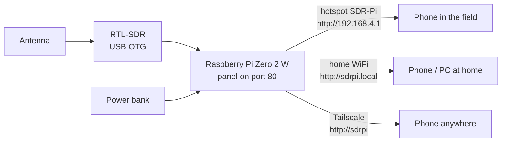

# SDR-Kit documentation

SDR-Kit turns a **Raspberry Pi Zero 2 W**, an **RTL-SDR** dongle and a **power bank** into a pocket spectrum analyzer (in the spirit of the tinySA), a multimode radio and a signal decoder. You use it from a phone, tablet or PC browser over WiFi: the Pi's own hotspot in the field, your home WiFi, or Tailscale from anywhere.

## Start here

| If you want to… | Read |
|---|---|
| Buy the parts and put them together | [Hardware](hardware.md) |
| Flash the microSD, install and connect for the first time | [Installation](installation.md) |
| Learn every tab, card and button of the panel | [User guide](user-guide.md) |
| Listen to DMR, P25, D-Star, YSF, NXDN, dPMR or M17 | [Digital voice](digital-voice.md) |
| Pick, cut and place an antenna | [Antennas](antennas.md) |
| Update to a new version or go back | [Updating](updating.md) |
| Fix something that does not work | [Troubleshooting](troubleshooting.md) |
| Look up a quick answer | [FAQ](faq.md) |

## Reference

| Document | Contents |
|---|---|
| [Configuration](configuration.md) | Every key in `/etc/sdrkit/sdrkit.conf`, its default and when it takes effect |
| [Architecture](architecture.md) | Components, processes, data flow, DSP chains, decoder pipelines, update system, security model, file layout |
| [HTTP API](api.md) | All REST and Server-Sent Events endpoints of the panel, with `curl` examples |
| [Development](development.md) | Repository layout, demo mode, tests and CI, conventions, translations, releases |
| [Legal](legal.md) | Receive-only operation, privacy of communications, encryption, codec patents, third-party licenses |

## At a glance

| Tab | What it does |
|---|---|
| **Analyzer** | Spectrum + waterfall, button tuner, 4 markers with delta, bench-style measurements, zero span, traces, limit line, 24/7 monitoring with phone alerts |
| **Radio** | FM, wide FM, WFM, AM, USB, LSB and digital voice; squelch, CTCSS/DCS/DTMF, data decoders, recording, scanner, seek, memories, fox-hunt mode |
| **Decode** | POCSAG/FLEX/APRS/EAS messages, 433/868/915 MHz sensors (rtl_433), offline aircraft radar (dump1090), catalog of every decoder |
| **Recordings** | WAV recordings by day and the activity log |
| **More** | Channels, frequency guide, antenna calculator, advanced receiver (OpenWebRX+), WiFi, system and updates |

Every card in the panel has an **ⓘ** button that explains what it is for. The panel is available in **English and Spanish**: switch with the **EN/ES** chip in the header or in **More → System**.

## Conventions used in these docs

- `sudo sdrkit …` commands run on the Raspberry Pi over SSH. The `sdrkit` command accepts English and Spanish command names (`update` = `actualizar`, `rollback` = `volver`…); these docs use the English names.
- Frequencies are in MHz unless noted. Levels are in dBFS (relative) unless the analyzer has been calibrated.
- Paths such as `/etc/sdrkit/sdrkit.conf` refer to the Raspberry Pi.

## Other languages

- Español: [docs/es/README.md](es/README.md) · [Guía completa](es/GUIA.md)
