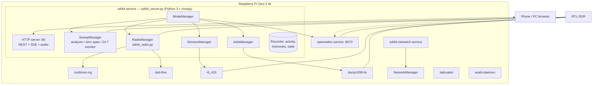
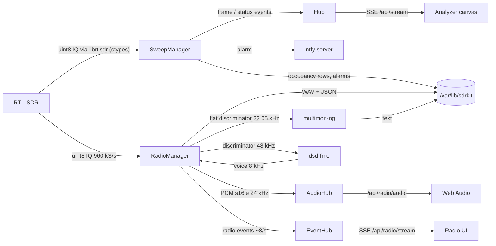
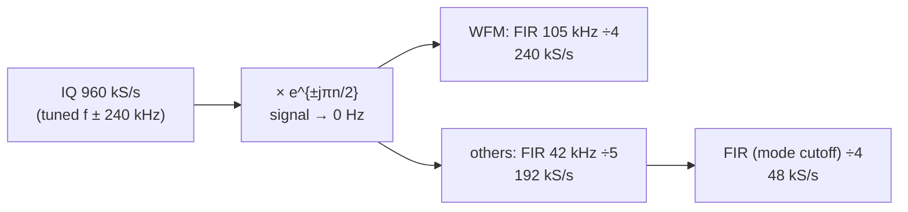
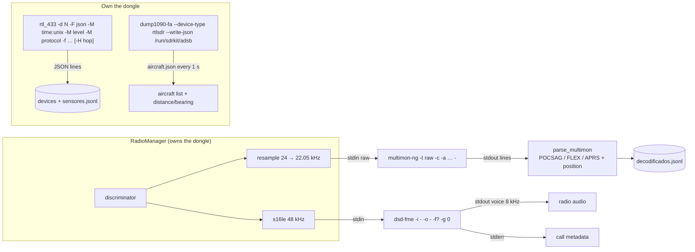

# Architecture

How SDR-Kit is put together: the processes running on the Pi, how samples flow from the dongle to the browser, the DSP chain of each mode, the external decoders, the update system, the security model and where everything lives on disk.

- [Components](#components)
- [Processes and threads](#processes-and-threads)
- [Dongle ownership: the mode manager](#dongle-ownership-the-mode-manager)
- [Data flow](#data-flow)
- [Analyzer engine](#analyzer-engine)
- [Radio DSP chains](#radio-dsp-chains)
- [Tone, DTMF and digital-signal detectors](#tone-dtmf-and-digital-signal-detectors)
- [Scanner and seek](#scanner-and-seek)
- [Recorder and logs](#recorder-and-logs)
- [Decoder pipelines](#decoder-pipelines)
- [OpenWebRX+ integration](#openwebrx-integration)
- [Network watchdog](#network-watchdog)
- [Update system](#update-system)
- [Security model](#security-model)
- [File layout on the Pi](#file-layout-on-the-pi)

## Components

| Component | Source | Role |
|---|---|---|
| Panel server | `files/sdrkit_server.py` | HTTP server, static panel, REST/SSE API, analyzer engine (librtlsdr through `ctypes` + numpy), mode manager, OpenWebRX+ glue, WiFi (via `nmcli`), system info, updates, demo simulator |
| Radio | `files/sdrkit_radio.py` | Demodulators, squelch, CTCSS/DCS/DTMF, recorder, activity log, memories, scanner |
| Decoders | `files/sdrkit_decoders.py` | multimon-ng, rtl_433, dump1090 and DSD-FME wrappers, digital-signal classifier, decoder catalog, demo signal encoders (POCSAG, APRS, M17) |
| Web panel | `files/web/` | Single-page app in vanilla JavaScript, no build step; i18n engine and English catalogs |
| CLI | `files/sdrkit-cli.sh` → `/usr/local/bin/sdrkit` | Shortcuts for status, WiFi, passwords, updates, logs |
| Updater | `files/sdrkit-update.sh` | Fetch, install, health-check, roll back |
| Network watchdog | `files/sdrkit-netwatch.sh` | Known WiFi or automatic hotspot |
| Shared shell library | `files/sdrkit-lib.sh` | Safe config parser, config merge, hotspot setup, CLI language |
| Installer | `install.sh`, `get.sh` | Two-stage installer, GitHub bootstrap |

The server uses only the Python standard library and numpy (`python3-numpy`): no web framework, no pip packages on the Pi.

## Processes and threads

| systemd unit | Command | Notes |
|---|---|---|
| `sdrkit.service` | `/usr/bin/python3 /opt/sdrkit/sdrkit_server.py` | Runs as **root** (needs `systemctl`, `nmcli`, reboot), `Nice=-2`, `Restart=always` |
| `sdrkit-netwatch.service` | `/bin/bash /opt/sdrkit/sdrkit-netwatch.sh` | `Restart=always` |
| `openwebrx.service` | OpenWebRX+ | **Disabled at boot**; started and stopped by the panel |
| `tailscaled.service` | Tailscale | Optional |
| `sdrkit-install` (transient) | `install.sh --stage2` via `systemd-run` | Survives SSH disconnects |
| `sdrkit-update` (transient) | `/run/sdrkit-update.sh --yes` via `systemd-run` | Started by the panel's *Update now*; survives the panel restart |

Threads inside `sdrkit_server.py`:

| Thread | Purpose |
|---|---|
| HTTP (`ThreadingHTTPServer`) | One thread per connection; long-lived for SSE and audio streams |
| `sweep` | Analyzer / zero-span / monitor worker |
| `radio` | Demodulation, detectors, recorder, scanner |
| `sensors`, `aviones` | Supervise `rtl_433` and `dump1090`, restart them if they exit |
| CPU sampler | Reads `/proc/stat` every 2 s |
| Mode switch | One short-lived thread per mode change |
| Decoder I/O | Writer/reader threads per `multimon-ng` and `dsd-fme` child (bounded queues; audio is dropped rather than blocking the radio) |
| ntfy | One short-lived thread per alert |

## Dongle ownership: the mode manager

An RTL-SDR can be opened by one program at a time. `ModeManager` gives the dongle to exactly one owner:

| Mode | Owner | Started by |
|---|---|---|
| `sweep` | SweepManager (native librtlsdr, `rtl_power` or `hackrf_sweep`) | Analyzer tab, 24/7 monitor |
| `radio` | RadioManager (native librtlsdr) | Radio tab, Listen buttons, message decoders, scanner |
| `sensors` | `rtl_433` | Decode → Sensors |
| `adsb` | `dump1090-fa` | Decode → Aircraft |
| `receiver` | OpenWebRX+ | More → Advanced receiver |
| `idle` | nobody | — |

A switch disables every other engine (each closes the device and confirms within 8 s), stops OpenWebRX+ unless it is the target, enables the target and persists the mode in `state.json`. At boot the mode comes from `DEFAULT_MODE` (`last` restores the persisted one). While a switch is running, further switches are refused (`400`).

Idle policy: the analyzer stops `SWEEP_IDLE_STOP` (20 s) after the last SSE client disconnects unless the monitor is enabled; the radio stops 20 s after the last audio/event client unless it is *monitoring* (auto-record, manual recording, scanner or data decoders). The dongle is then released, but the mode stays the same.

## Data flow

- **Analyzer frames** are JSON arrays of rounded dB values (one per display point, `null` where not measured), pushed to all viewers through one shared hub; slow clients simply get the latest frame.
- **Radio audio** is raw little-endian 16-bit mono PCM at 24 kHz over a never-ending HTTP response; the browser schedules it with Web Audio. When no audio arrives for 3 s the server sends 100 ms of silence to keep the connection open.
- **Radio events** (level, squelch, tones, scanner state, decoded messages, digital-voice metadata, and a 256-bin panorama on every other event) are published at most every 120 ms.

## Analyzer engine

The native engine samples at **2.4 MS/s** and assembles a sweep from overlapping tuning hops.

| Aspect | Implementation |
|---|---|
| Usable bandwidth per hop | ±0.45 × 2.4 MHz (the flat part of the RTL2832 filter) |
| DC spike | A gap of max(1.5 bins, 1.5 kHz) around each hop's centre is discarded; hops are spaced so the neighbour covers it |
| Narrow spans (≤ 840 kHz) | A single tuning offset by 600 kHz, so DC falls outside the screen |
| FFT size | 64–8192 points, chosen from the display bin width; Hann window; **RBW ≈ 1.5 × bin width** |
| Averaging (*Detail*) | Fast / Normal / Fine = 8 k / 32 k / 128 k samples (single tuning) or 4 k / 16 k / 64 k per hop |
| Detectors | Peak (max per display point), Average (power mean), Sample |
| Settling | 5 ms + 4096 discarded bytes after every retune |
| Rate limit | `SWEEP_MAX_FPS` (12) |
| Range | 100 kHz (V3 direct sampling) / 0.5 MHz (V4) / 24 MHz (other tuners) to 1766 MHz; HackRF 1–6000 MHz |

**Zero span** retunes to 960 kS/s at f − 240 kHz, shifts the target to 0 Hz with an exact quarter-rate mixer, decimates by 4 (240 kS/s), applies the RBW as two cascaded moving averages (triangular response), converts to dB and, with a level trigger, aligns the first crossing with 10 % pre-trigger.

**Fallback engines** parse CSV from `rtl_power` (when numpy is missing or forced) or `hackrf_sweep` (HackRF One detected and `hackrf_sweep` installed).

**24/7 monitor**: after each complete sweep it accumulates per-point maximum and the share of sweeps above a threshold (the alarm limit, or median + 10 dB). Every `every` seconds it emits an occupancy row (kept in memory, up to 1440 rows, and appended to `ocupacion.jsonl`). Alarms trigger when the highest point inside [fmin, fmax] exceeds the limit, at most once per cooldown (30 s), and go to `alarmas.jsonl`, the status line and ntfy.

## Radio DSP chains

The radio samples at **960 kS/s** and tunes **240 kHz (fs/4) away** from the wanted frequency, so the DC spike and LO leakage stay out of the channel; an exact quarter-rate complex mixer brings the signal to 0 Hz. Blocks are 48 640 samples (~50.7 ms) and the block mean is removed first.

| Mode | Channel filter | Demodulation and audio (→ 24 kHz) |
|---|---|---|
| **WFM** | 105 kHz @ 240 kS/s | FM discriminator scaled to ±75 kHz; one 255-tap FIR combining de-emphasis (75 µs Americas / 50 µs Europe) and an 11.5 kHz low-pass, ÷10 |
| **FM** (`nfm`) | 7.5 kHz @ 48 kS/s | Discriminator in Hz, normalised to 3 kHz deviation; 300 Hz–3.4 kHz band-pass with 750 µs de-emphasis (removes the sub-audible tone), ÷2 |
| **Wide FM** (`nfmw`) | 11 kHz @ 48 kS/s | As FM, normalised to 5 kHz deviation |
| **AM** | 5.5 kHz @ 48 kS/s | Envelope, slow DC tracking, 200 Hz–4 kHz band-pass, ÷2, AGC |
| **USB / LSB** | 3.2 kHz @ 48 kS/s | Weaver-style: shift by ∓1.5 kHz, 1.4 kHz low-pass, shift back, real part; 250 Hz–2.8 kHz band-pass, ÷2, AGC |
| **Digital** (`dsd`) | 8 kHz @ 48 kS/s | Raw discriminator (Hz, 48 kHz) piped to `dsd-fme`; its 8 kHz voice is resampled to 24 kHz |

Side paths for FM:

| Path | Chain | Feeds |
|---|---|---|
| Sub-audible | discriminator → 1 kHz LPF ÷8 (6 kS/s) → 300 Hz LPF ÷6 (**1 kS/s**) | CTCSS / DCS detectors |
| Flat audio | discriminator / 6 kHz → 6 kHz LPF ÷2 (24 kHz) | multimon-ng (only when data decoders are on) |
| Discriminator | Hz at 48 kS/s | Digital-signal classifier, DSD-FME |

**Squelch** compares the channel power (after the second filter, plus `LEVEL_OFFSET_DB`) with the threshold, with 2 dB hysteresis and 250 ms audio hang. The noise floor shown in the meter is the 15th percentile of the last 200 blocks; the panel's *Auto* button sets squelch = noise + 8 dB. A transmission ends 1.2 s after the squelch closes.

## Tone, DTMF and digital-signal detectors

| Detector | Method | Acceptance |
|---|---|---|
| **CTCSS** | ~2.4 s of sub-audible deviation at 1 kS/s, Hann window, 16 384-point FFT over 60–262 Hz, parabolic peak interpolation, nearest of the 50 standard tones | SNR ≥ 18 dB over the band median, within max(1 Hz, 0.8 %); evaluated every 0.5 s after 1.3 s of open squelch; shown when two consecutive results agree |
| **DCS** | Bit timing at 134.4 bit/s tried at 12 phases; soft bits folded over the 23-bit Golay (23,12) word and correlated against all 104 codes × 23 rotations (both polarities) | Normalised correlation ≥ 0.88; ties prefer normal polarity; equivalent code shown (e.g. `D023N ≡ D047I`) |
| **DTMF** | 30 ms frames, 15 ms hop at 24 kHz; correlation at the 8 DTMF tones and at ±3.5 % off-tones | Both tones dominate the frame energy, each tone exactly on frequency, twist 0.1–10, the same key in 3 consecutive frames with steady power (rejects voice) |
| **Digital classifier** | ~0.7 s of discriminator: AFSK 1200 check, steady-tone rejection, symbol-rate line in the derivative of the smoothed signal (512…9600 baud), level count at symbol centres | Spectral-line score ≥ 25; see [Digital voice](digital-voice.md#level-1-automatic-identification) |

DCS words are generated with the same Golay computation used by the open firmware of the Quansheng UV-K5.

## Scanner and seek

Channels are sorted and grouped into **windows**: one tuning (the first channel + 384 kHz) covers every channel up to ~780 kHz above the first (the LO is nudged 25 kHz if a channel would sit on it). Each step tunes, discards 4096 bytes, reads 8192 samples, averages 1024-point FFTs and integrates the power over each channel's bandwidth (12.5 kHz FM, 25 kHz wide FM/AM, 180 kHz WFM). The strongest channel above the squelch wins; otherwise the next window is measured.

| Event | Behaviour |
|---|---|
| Signal found | Tune and listen (`listen` state), hit counter + 1 |
| Squelch closed for 2 s | Resume searching from the next window |
| Skip / 🚫 10 min | Next window / lock the channel out for N minutes |
| Seek (`once`) | Stops on the first hit and ends the scan; reports when nothing is above the squelch |

Limits: 4000 channels per scan, 1 kHz minimum step for ranges.

## Recorder and logs

| Item | Format | Location |
|---|---|---|
| Recordings | WAV, 16-bit mono 24 kHz, plus a JSON sidecar (frequency, mode, name, start, duration, peak, CTCSS/DCS/DTMF) | `<REC_DIR>/YYYY-MM-DD/HH-MM-SS_<freq>MHz_<mode>[_<name>].wav` |
| Auto recording | Opens when the squelch opens (with 0.6 s pre-roll), closes 2 s after it closes; one file per transmission and per frequency | |
| Space management | Delete oldest until 90 % of `REC_MAX_MB`; refuse below 300 MB free; drop files shorter than `REC_MIN_SEC` | |
| Activity log | JSON lines, last 1000 kept in memory, file trimmed above 2 MB | `actividad.jsonl` |
| Decoded messages | JSON lines, last 2000 | `decodificados.jsonl` |
| Sensors | JSON lines, rotated at 4 MB | `sensores.jsonl` (+ `.1`) |

## Decoder pipelines

| Decoder | Modes / options |
|---|---|
| multimon-ng | `pocsag` → POCSAG512/1200/2400 · `flex` → FLEX · `aprs` → AFSK1200 · `eas` → EAS · `selcall` → ZVEI1/2/3, CCIR, EEA, EIA · `cw` → MORSE_CW · `fms` → FMSFSK |
| rtl_433 | Band presets `433`, `315`, `868`, `915`, `345`, `433+868`, `433+315`, `433+915`; frequency hopping every 10–600 s when two bands are set; 1024 kS/s for 868/915 MHz |
| dump1090-fa | Gain (default 49.6 dB), receiver location from config or panel; aircraft older than 60 s are dropped; distance and bearing computed in the server |
| dsd-fme | See [Digital voice](digital-voice.md#how-the-panel-feeds-dsd-fme) |

Each wrapper restarts its process after a crash (4 s back-off) and reports errors such as *rtl_433 is not installed* in the panel. `sdrkit_decoders.status()` builds the **All modes** catalog by checking for the required binaries, for OpenWebRX+ (`/usr/bin/openwebrx`) and for an AMBE device in `/etc/codecserver/codecserver.conf`.

## OpenWebRX+ integration

- Installed from the OpenWebRX+ repository (`https://luarvique.github.io/ppa`), disabled at boot, started with `systemctl` when the panel switches to `receiver`.
- On first install the panel **seeds** `/var/lib/openwebrx/settings.json` with receiver name/location, up to 3 clients, WFM de-emphasis by region and an RTL-SDR device with band profiles (FM in 2 MHz slices, airband, 2 m, marine, ISM 433/70 cm, FRS/GMRS or PMR446, ADS-B, and HF profiles for V3/V4). Existing devices are left alone; `sudo sdrkit profiles` forces a rewrite.
- Opening the receiver on a frequency inserts a first profile `sdrkit-target` centred 25 % of the sample rate away from the frequency (out of the DC spike) and restarts OpenWebRX+.
- The `admin` user shares `ADMIN_PASSWORD`.

## Network watchdog

`sdrkit-netwatch.sh` polls NetworkManager every 10 s:

1. At boot, wait up to `BOOT_WAIT` s for a client connection; otherwise bring up the hotspot connection (`sdrkit-hotspot`: AP mode, WPA2-PSK/CCMP, band bg, `ipv4.method shared`).
2. Client connected → nothing to do.
3. Hotspot up, **no stations** and `HOME_RETRY_MIN` elapsed → drop the hotspot, rescan, connect to the highest-priority visible known network, else bring the hotspot back.
4. Neither client nor hotspot for `LOST_GRACE` (40 s) → hotspot.
5. `/run/sdrkit/netmode` = `hotspot` (set by the panel or `sdrkit hotspot`) pins the hotspot.

## Update system

Summarised here, detailed in [Updating](updating.md).

| Piece | Role |
|---|---|
| `/opt/sdrkit-src` | Git clone (depth 100) of `SDRKIT_REPO` / `SDRKIT_BRANCH` |
| `INSTALL_REV` in `install.sh` vs `/var/lib/sdrkit/install_rev` | Decides quick (`install.sh --panel`) vs full install |
| `/opt/sdrkit.prev` | Copy of the previous panel for rollback |
| `/var/lib/sdrkit/commit`, `prev_commit` | Installed and previous commits; `commit` is written only after a successful health check |
| `/run/sdrkit-update.lock` | Single-update lock |
| `/run/sdrkit-update.sh` | The updater runs from a copy so it can replace its own file |

## Security model

| Aspect | Design |
|---|---|
| **Exposure** | Plain HTTP on port 80 (and OpenWebRX+ on 8073), meant for the **local network, the Pi's own WPA2 hotspot and Tailscale**. Do not port-forward it to the internet |
| **Authentication** | One shared password, `ADMIN_PASSWORD`. `POST /login` compares it in constant time; a wrong password costs a 1 s delay |
| **Session cookie** | `sdrkit_auth` = HMAC-SHA256(secret, `"v1:" + password`), `HttpOnly`, `SameSite=Lax`, 30 days. The 32-byte secret is generated once in `/var/lib/sdrkit/secret` (mode 600). Changing the password invalidates every session |
| **No password** | If `ADMIN_PASSWORD` is empty, the panel is open to anyone on the network |
| **API** | Every `/api/*` route requires the cookie (`401 {"error":"auth"}` otherwise); only `/login`, `/logout`, the icons and the manifest are public |
| **Transport** | No TLS. The hotspot is WPA2; Tailscale encrypts remote access end to end (WireGuard). On a shared LAN, traffic — including the login — is readable by others on that LAN |
| **Input handling** | Request bodies limited to 64 KiB; static files restricted to `[a-z0-9_.-]` names with known extensions; recording paths resolved with `realpath` and confined to the recordings folder; WiFi connection UUIDs validated; numeric parameters clamped |
| **Privileges** | The server runs as root because it controls systemd units, NetworkManager, power and OpenWebRX+ settings. Child decoders inherit it |
| **Secrets on disk** | `/etc/sdrkit/sdrkit.conf` (mode 600) holds the panel and hotspot passwords in clear text; the config parser never executes it |
| **OpenWebRX+** | Listening is open to up to 3 clients on port 8073; its settings require the `admin` user |
| **Outbound traffic** | Only when configured or requested: ntfy alerts, GitHub (updates), Tailscale, apt (installer) |

## File layout on the Pi

| Path | Contents |
|---|---|
| `/opt/sdrkit/` | Installed panel: `sdrkit_server.py`, `sdrkit_radio.py`, `sdrkit_decoders.py`, `demo_m17.sym`, `sdrkit-update.sh`, `sdrkit-lib.sh`, `sdrkit-netwatch.sh`, `sdrkit-cli.sh`, `VERSION`, `web/` |
| `/opt/sdrkit.prev/` | Previous version (rollback) |
| `/opt/sdrkit-src/` | Git clone used by `get.sh` and the updater |
| `/usr/local/bin/sdrkit` | CLI |
| `/etc/sdrkit/sdrkit.conf` | Configuration (mode 600); `.bak` after `sdrkit config`, `.antes-de-actualizar` before each update |
| `/etc/systemd/system/sdrkit.service`, `sdrkit-netwatch.service` | Services |
| `/etc/avahi/services/sdrkit.service` | mDNS announcement of the panel (`_http._tcp`) |
| `/etc/modprobe.d/sdrkit-blacklist-dvb.conf` | Keeps the DVB-T kernel driver off the dongle |
| `/etc/NetworkManager/conf.d/sdrkit-powersave.conf` | WiFi power saving off |
| `/etc/systemd/journald.conf.d/sdrkit.conf` | Journal in RAM (with `REDUCE_SD_WRITES`) |
| `/etc/codecserver/codecserver.conf` | `[device:sdrkit-ambe]` section (with `AMBE_TTY`) |
| `/var/lib/sdrkit/` | `state.json` (mode, analyzer/radio/sensor/ADS-B parameters, calibration, monitor, location), `secret`, `memorias.json`, `actividad.jsonl`, `decodificados.jsonl`, `sensores.jsonl`, `ocupacion.jsonl`, `alarmas.jsonl`, `grabaciones/`, `commit`, `prev_commit`, `install_rev` |
| `/var/lib/openwebrx/settings.json` | OpenWebRX+ settings seeded by SDR-Kit |
| `/run/sdrkit/netmode` | `auto` or `hotspot` |
| `/run/sdrkit/adsb/aircraft.json` | dump1090 output |
| `/var/log/sdrkit-install.log`, `/var/log/sdrkit-update.log` | Installer and updater logs |
| `/usr/local/bin/dsd-fme`, `/usr/local/share/sdrkit-dsd.ver` | Optional DSD-FME build and its pinned version |
| `/var/swap.sdrkit` or `/etc/dphys-swapfile` | 1 GB swap for the installation |
