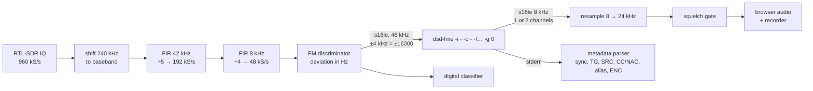

# Digital voice

SDR-Kit handles digital radio at three levels:

| Level | What you get | Needs |
|---|---|---|
| **1. Identify** | The panel tells you what kind of digital signal you are hearing | Nothing — always included |
| **2. Listen in the panel** | Voice and call metadata for DMR, P25 phase 1, D-Star, YSF, NXDN, dPMR, M17 and ProVoice in the **Radio** tab | **DSD-FME** (optional build, patent notice) |
| **3. Licensed codec** | DMR, D-Star, YSF and NXDN voice in the advanced receiver using a hardware AMBE vocoder | An **AMBE3000 USB dongle** |


> [!IMPORTANT]
> Only **unencrypted** voice can be heard. Encrypted calls are shown as encrypted and stay silent; SDR-Kit never attempts to decrypt anything. See [Legal](legal.md).

## Supported systems

| Panel option | DSD-FME flag | System | Audio channels |
|---|---|---|---|
| **Auto (DMR · P25 · D-Star · YSF)** | `-fa` | Auto-detection of DMR, P25 phase 1, D-Star, YSF (and X2-TDMA) | 2 |
| **DMR** | `-fs` | DMR / MotoTRBO / Hytera, Tier I–II | 2 (TDMA slots, mixed) |
| **P25** | `-f1` | APCO-25 phase 1 | 1 |
| **D-Star** | `-fd` | Icom D-Star | 1 |
| **Fusion** | `-fy` | Yaesu System Fusion (C4FM) | 1 |
| **NXDN 6.25** | `-fi` | NXDN48 / IDAS, 6.25 kHz | 1 |
| **NXDN 12.5** | `-fn` | NXDN96, 12.5 kHz | 1 |
| **dPMR** | `-fm` | dPMR / dPMR446 | 1 |
| **M17** | `-fz` | M17 (amateur radio, open Codec2 voice) | 1 |
| **ProVoice** | `-fp` | ProVoice / EDACS | 1 |

**Auto** recognises DMR, P25 phase 1, D-Star and YSF. **NXDN, dPMR, M17 and ProVoice must be selected explicitly.**

## Level 1: automatic identification

While the Radio listens in **FM** (or **Digital**) and the squelch is open, the panel analyses about 0.7 s of the FM discriminator output at a time and estimates:

1. **AFSK 1200** (APRS/packet) from the 1200/2200 Hz tone pair in the audio;
2. otherwise, rejects steady tones (a test tone or a carrier with a single audio tone is analogue);
3. the **symbol rate**, from the spectral line of the derivative of the smoothed discriminator signal at 512, 1200, 1600, 2400, 3600, 4800, 6000 or 9600 baud;
4. the number of **levels** (2-FSK/GMSK vs 4-FSK), by sampling at the symbol centres and counting how many samples fall on the inner levels.

| Detected | Probably |
|---|---|
| 4FSK 4800 baud | DMR, P25 phase 1, Yaesu Fusion (C4FM) or M17 |
| 4FSK 2400 baud | NXDN 6.25 kHz or dPMR |
| 4FSK 6000 baud | P25 phase 2 (TDMA) |
| GMSK 4800 | D-Star (or 4800 data) |
| GMSK 9600 | AIS, 9600 packet or data |
| 2FSK 512 / 1200 / 2400 | POCSAG 512 / 1200 / 2400 |
| 2FSK 1600 / 4FSK 1600 | FLEX / FLEX 3200 |
| AFSK 1200 | APRS / packet |

A banner in the Radio shows the result, the estimated deviation and one-tap actions:

| Detected | Buttons offered |
|---|---|
| 4FSK 4800 | Decode voice (Auto) · Try M17 |
| 4FSK 2400 | Decode NXDN (6.25) · Try dPMR |
| GMSK 4800 | Decode D-Star |
| 4FSK 6000 | P25 phase 2 (only with a control channel) |
| 2FSK 512/1200/2400 | Read POCSAG messages |
| FLEX | Read FLEX messages |
| AFSK 1200 | Read APRS / packet |

The detected type is also stored with each transmission in the [activity log](user-guide.md#recordings). The identifier runs without DSD-FME.

> [!TIP]
> Digital signals look like flat-topped blocks with straight edges in the analyzer and sound like a rhythmic buzz in FM.

## Level 2: DSD-FME in the panel

### Installing

DSD-FME and mbelib are **not installed by default**. Accept them during installation, or later run `sudo sdrkit install-dsd` (or set `INSTALL_DSD="yes"` with `sudo sdrkit config` and re-run the installer). The build takes 30–50 minutes on a Pi Zero 2 W. See [Installation](installation.md#optional-digital-voice-in-the-panel-dsd-fme).

> [!WARNING]
> **Patent notice.** DSD-FME relies on **mbelib**, a software implementation of the AMBE/IMBE vocoders. These codecs are **patented**; in some countries using them without a licence may infringe those patents. DSD-FME is free software for study and personal use and the choice is yours. Read the full notice: <https://github.com/lwvmobile/mbelib#readme>.

### Using it

1. In the **Radio**, choose the **Digital** mode (or tap a decode button in the detection banner).
2. In the **Digital voice (DSD-FME)** card, pick the system. Use *Auto* for DMR, P25, D-Star and YSF.
3. Press **▶ Listen on this phone**. When an unencrypted call arrives, the voice plays and can be [recorded](user-guide.md#record) like any other mode.

| Field | Shows |
|---|---|
| **System** | Sync type reported by DSD-FME (for example `DMR`, `P25p1`, `M17`), marked *receiving* while live |
| **Target / group** | Talkgroup or destination; below it the DMR **colour code** or P25 **NAC** |
| **Source** | Radio ID or callsign of the speaker; below it the **talker alias** if transmitted |
| Status line | *Decoding…*, *encrypted call*, or a hint to try another system |
| Log | The last lines of DSD-FME's own output |

Where to look for signals:

- Amateur DMR, D-Star, Fusion and M17 repeaters (430–450 MHz, and 2 m);
- business and public-safety radios (150–174 and 450–470 MHz);
- dPMR446 / DMR446 (446.0–446.2 MHz);
- M17 calling frequency 433.475 MHz.

**More → Channels** has ready-made digital channels (dPMR446, DMR simplex, M17 calling, D-Star calling, 800 MHz P25).

### How the panel feeds DSD-FME



- The radio's channel filter for Digital mode is 8 kHz wide at 48 kS/s; the raw (un-de-emphasised) discriminator is what a scanner's "discriminator tap" would provide.
- `dsd-fme` runs as a child process with stdin/stdout pipes and is restarted whenever you change frequency, mode or system.
- For DMR (two TDMA slots) the two output channels are mixed into one.
- The panel keeps at most 2 s of decoded audio queued, so latency stays bounded on a busy CPU.
- Call metadata is parsed from DSD-FME's text output (ANSI colours stripped). A line mentioning `ENC`, `Encrypted`, `ALG ID` or `Enc Identifier` (and not `Clear`) marks the call as encrypted.

### What the panel does not do

- It does **not decrypt** anything and passes no keys to DSD-FME. Encrypted calls show **🔒 encrypted call** and remain silent.
- It does **not follow trunked systems**: P25 is decoded on a fixed channel only (no control-channel tracking).
- P25 phase 2 is identified but not decoded.

## Level 3: licensed path (AMBE3000 dongle)

A USB dongle with a DVSI **AMBE3000** chip (ThumbDV, DVstick 30) is a licensed hardware vocoder. SDR-Kit configures it for the **advanced receiver** (OpenWebRX+), through `codecserver`:

1. Plug in the dongle and find its device, usually `/dev/ttyUSB0`.
2. Set `AMBE_TTY="/dev/ttyUSB0"` (and `AMBE_BAUD`, default `921600`; older ThumbDV units use `460800`) with `sudo sdrkit config`.
3. Re-run the installer (`sudo bash /opt/sdrkit-src/install.sh`). It appends this section to `/etc/codecserver/codecserver.conf` and enables `codecserver`:

   ```ini
   [device:sdrkit-ambe]
   driver=ambe3k
   tty=/dev/ttyUSB0
   baudrate=921600
   ```

4. Open **More → Advanced receiver** and tune a DMR, D-Star, YSF or NXDN channel.

**Decode → All modes** shows whether the AMBE dongle is configured. M17 (Codec2) and FreeDV need no dongle in OpenWebRX+ either.

> [!NOTE]
> The project's decoder catalog also lists P25 for this path; whether OpenWebRX+ decodes P25 voice depends on the OpenWebRX+ version installed from its repository.

## Troubleshooting digital voice

| Symptom | Fix |
|---|---|
| *DSD-FME is not installed* | Install it as described [above](#installing) |
| No voice, nothing detected | Try another system: NXDN, dPMR and M17 are not auto-detected. Check the signal opens the squelch |
| *Encrypted call* | Cannot be heard with any receiver without the system key |
| Detected as 4FSK 2400 but no audio in NXDN 6.25 | Try dPMR (same symbol rate) |
| Detected as 4FSK 4800 but no audio in Auto | Try M17 |
| Choppy audio | Weak signal (raise gain, better antenna) or overloaded CPU (close other tabs and clients) |

More in [Troubleshooting](troubleshooting.md#radio-and-digital-voice).

## Try it without hardware

The [demo mode](development.md#running-the-demo-server) includes a **real M17 transmission** (Codec2 voice, callsign XE1SDR) at **433.475 MHz**, decoded end to end when DSD-FME is installed on your computer, plus DMR-like (443.45 MHz) and NXDN-like (451.0125 MHz) signals that exercise the identifier.
