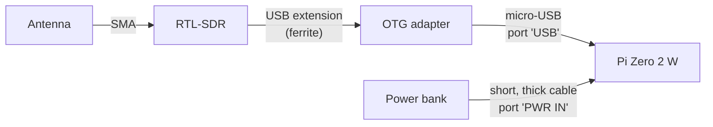

# Hardware

SDR-Kit needs four things: a Raspberry Pi Zero 2 W, an RTL-SDR dongle, a microSD card and a USB power bank. This page explains what to buy, why, and how to put it together.

- [Bill of materials](#bill-of-materials)
- [Power](#power)
- [RTL-SDR Blog V4 notes](#rtl-sdr-blog-v4-notes)
- [Other SDRs](#other-sdrs)
- [Assembly](#assembly)
- [Honest limits of the hardware](#honest-limits-of-the-hardware)

## Bill of materials

### Required

| Part | Recommendation | Why |
|---|---|---|
| SDR | **RTL-SDR Blog V4** (kit with dipole antennas) | 0.5–1766 MHz including HF without accessories, TCXO (no frequency drift, `RTL_PPM="0"`), software bias-tee, metal case |
| Computer | **Raspberry Pi Zero 2 W** | Quad-core, enough for the panel and 1–2 simultaneous listeners; WiFi on board |
| microSD | 32 GB, class **A1/A2** (SanDisk, Samsung) | Fast random I/O and reliability; the installer warns below 2.5 GB free |
| OTG adapter | micro-USB male → USB-A female, **short** | The Zero only has micro-USB ports |
| Power bank | 10 000–20 000 mAh, **5 V / 2.4 A** or more | Pi + dongle draw about 2.5–4 W |
| Power cable | micro-USB, **short and thick** | Long or thin cables cause undervoltage |
| Heatsink | Stick-on aluminium or copper | Digital voice and the analyzer keep the CPU busy |

### Strongly recommended

| Part | Why |
|---|---|
| **Short USB extension with ferrite** (15–30 cm) between Pi and dongle | Moves the dongle away from the Pi's own RF noise: a visibly cleaner spectrum |
| **Ventilated case** | Cooling. In a metal case the antenna must stay outside |
| **Discone antenna** (25–1300 MHz), or the V4 dipole kit | Wideband reception for the scanner and the analyzer. See [Antennas](antennas.md) |

### Optional

| Part | What it adds |
|---|---|
| **AMBE3000 USB dongle** (ThumbDV, DVstick 30) | Licensed AMBE codec for digital voice in the advanced receiver (`AMBE_TTY`). See [Digital voice](digital-voice.md#level-3-licensed-path-ambe3000-dongle) |
| **Second RTL-SDR** | Aircraft radar or sensors 24/7 while you use the analyzer (manual setup; the panel drives one dongle at a time) |
| **HackRF One** | Analyzer sweep from 1 MHz to 6 GHz (WiFi, Bluetooth, drones, cellular). Detected automatically when `hackrf_sweep` is installed (the installer adds `hackrf` for you; on older installs run `sudo apt install hackrf`) |
| **Noise source** | With *Normalize*, measure filters, duplexers and antennas like a scalar analyzer |
| **FM band-stop filter** | Prevents overload if you live near broadcast transmitters |
| **LNA powered by bias-tee** | Weak satellite, GPS and distant ADS-B signals |
| **Raspberry Pi 4/5** | OpenWebRX+ with several listeners and heavy decoders (FT8, DAB) at the same time |

## Power

The Raspberry Pi Zero 2 W and the RTL-SDR together draw roughly **2.5–4 W** from 5 V. The Pi reports **undervoltage** when its input drops below its threshold; the RTL-SDR then misbehaves first (USB read errors, dropped samples).

| Battery | Expected runtime |
|---|---|
| 10 000 mAh | 6–10 hours |
| 20 000 mAh | 12–20 hours |

Runtime depends on the mode: the analyzer and digital voice keep the CPU busier than the idle panel.

Choose a power bank that:

- delivers **5 V at 2.4 A or more** per port;
- keeps its output on with a steady ~0.5–0.8 A load (some banks switch off with small loads);
- is used with a **short, thick** micro-USB cable plugged into the **PWR IN** port.

How to check power health:

| Where | What you see |
|---|---|
| Panel header | A **⚡ undervoltage** chip appears while the voltage is low |
| More → System → *Power* tile | `OK`, or a red undervoltage warning (happening now, or happened since boot) |
| SSH: `sdrkit status` | `throttled=0x0` is fine; `0x50005` means undervoltage now and since boot |

> [!WARNING]
> Always shut down from **More → System → ⏻ Shut down** (or `sudo poweroff`) before unplugging the battery. Pulling power during writes can corrupt the microSD.

## RTL-SDR Blog V4 notes

| Topic | Details |
|---|---|
| Tuner | R828D. The panel reads the tuner type and sets the lower limit to **0.5 MHz** |
| HF (0.5–28.8 MHz) | The V4 receives HF through its **built-in upconverter**, handled by the RTL-SDR Blog driver. No direct-sampling mod or external upconverter is needed. Use a long-wire antenna for HF |
| Driver | Raspberry Pi OS **Trixie** ships a driver that supports the V4. On **Bookworm** the installer builds the RTL-SDR Blog driver (`RTLSDR_DRIVER="auto"`) and holds the packages so `apt` does not replace them |
| Frequency accuracy | 1 PPM TCXO: leave `RTL_PPM="0"` |
| Bias-tee | Set `BIAS_TEE="yes"` to power an LNA or active antenna through the coax. Applied by the panel's analyzer and radio, `hackrf_sweep` and OpenWebRX+; not by `rtl_433`, `dump1090` or the `rtl_power` fallback engine |
| Connector | SMA female: the antenna needs an SMA male plug (or an adapter) |
| USB ID | `0bda:2838` (`lsusb` must show it) |

> [!WARNING]
> Never enable the bias-tee with an antenna that is a DC short (many loops, folded dipoles and some discones). The 4.5 V supply would be shorted.

### RTL-SDR Blog V3 and other RTL2832U dongles

- **V3 (R820T/R820T2):** below 24 MHz the panel switches to **direct sampling (Q branch)** automatically, and the OpenWebRX+ HF profiles enable it when `RTL_MODEL="v3"`. Reception starts at about 100 kHz but sensitivity is lower than the V4.
- **Other tuners (E4000, FC0012/13, FC2580):** the panel's lower limit is 24 MHz.
- All RTL2832U dongles top out at **1766 MHz**.
- V3 and V4 support is checked on every change: `tests/test_rtl_models.py` runs the panel's driver code against a fake librtlsdr that reports each dongle's tuner. It verifies the software side (detection, gains, direct-sampling switching); real-world sensitivity still depends on the hardware.

### Using an upconverter or LNB

For HF with a dongle that has no HF support, or for microwave bands with an LNB, enter the converter's local-oscillator frequency in **Analyzer → Units, calibration and converter → Converter (MHz)** so the display shows real frequencies (for example `-125` for a 125 MHz HF upconverter, `9750` for a 9.75 GHz LNB).

## Other SDRs

| Device | Support |
|---|---|
| RTL2832U dongles | Full: analyzer, zero span, radio, decoders, OpenWebRX+ |
| HackRF One | **Analyzer sweep only** (1–6000 MHz) through `hackrf_sweep`. Zero span, radio and decoders still need an RTL-SDR |
| Airspy, SDRplay | Listed in More → System when connected, but no SDR-Kit engine uses them |

## Assembly

1. Stick the heatsink on the processor.
2. Plug the **OTG adapter into the port labelled `USB`** (the one in the middle of the board). The corner port, **`PWR IN`**, is power only.
3. Connect the dongle to the USB extension and the extension to the OTG adapter. Screw the antenna onto the dongle's SMA connector.
4. Connect the power bank with the short cable to **`PWR IN`**.

> [!TIP]
> If the panel says *No RTL-SDR detected*, the OTG adapter is almost always in the `PWR IN` port, or the cable/battery cannot supply enough current. See [Troubleshooting](troubleshooting.md#hardware-and-power).

### Cooling

The **More → System → Temperature** tile turns red above **75 °C**; the Pi firmware starts throttling the CPU at around 80 °C. A heatsink and a ventilated case keep the Zero 2 W well below that during digital voice decoding.

### Bluetooth

SDR-Kit uses WiFi only. WiFi and Bluetooth share the same radio chip on the Zero 2 W, so the installer disables Bluetooth (`DISABLE_BLUETOOTH`) to improve WiFi and save power. Bluetooth would not have the bandwidth for the waterfall plus audio anyway.

## Honest limits of the hardware

| Limit | Consequence |
|---|---|
| One dongle does **one thing at a time** | Analyzer, radio, sensors, aircraft or advanced receiver. The panel switches the dongle between them automatically. A second function at the same time needs a second dongle |
| 512 MB RAM, 4 × Cortex-A53 | 1–2 simultaneous listeners. Heavy decoders (FT8, DAB) are better on a Pi 4/5 |
| 2.4 GHz WiFi only | The Zero 2 W has no 5 GHz radio. iPhone hotspots need *Maximize Compatibility* |
| Receive only | The RTL-SDR cannot transmit; there is no tracking generator |
| Up to 1766 MHz | Higher frequencies need a HackRF (analyzer only) or a downconverter |
| Levels are relative | dBFS out of the box; calibrate with a known signal for dBm (expect ±2–3 dB) |

Next: [Installation](installation.md).
