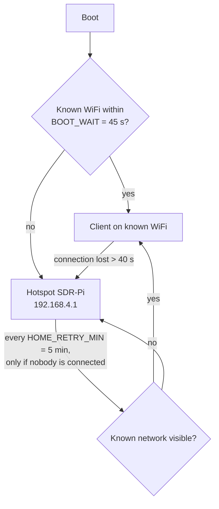

# Installation

This page takes you from a blank microSD card to the panel on your phone. Plan on **20–45 minutes** of unattended installation, plus **30–50 minutes** more if you choose to build the optional digital-voice decoder.

- [Requirements](#requirements)
- [1. Flash Raspberry Pi OS](#1-flash-raspberry-pi-os)
- [2. First boot and SSH](#2-first-boot-and-ssh)
- [3. Install (one command)](#3-install-one-command)
- [What the installer does](#what-the-installer-does)
- [Offline install from the microSD](#offline-install-from-the-microsd)
- [4. First connection](#4-first-connection)
- [Optional: digital voice in the panel (DSD-FME)](#optional-digital-voice-in-the-panel-dsd-fme)
- [Re-running and repairing an installation](#re-running-and-repairing-an-installation)

## Requirements

| Item | Notes |
|---|---|
| Hardware | Assembled as described in [Hardware](hardware.md) |
| Operating system | **Raspberry Pi OS Lite (64-bit)**, Trixie (recommended) or Bookworm. Other releases are rejected by the installer |
| Network | Internet on the Pi during installation (your home WiFi, 2.4 GHz) |
| A computer | To flash the card; SSH from a PC, or from a phone app such as Termius |

## 1. Flash Raspberry Pi OS

1. Install **Raspberry Pi Imager**: <https://www.raspberrypi.com/software/>
2. Choose:
   - **Device:** Raspberry Pi Zero 2 W
   - **Operating system:** *Raspberry Pi OS (other)* → **Raspberry Pi OS Lite (64-bit)**
   - **Storage:** your microSD
3. Open the customisation settings (⚙ / *Edit settings*) and set:

   | Setting | Value |
   |---|---|
   | Hostname | **`sdrpi`** (gives you `http://sdrpi.local`) |
   | Username and password | Your choice (used for SSH and `sudo`) |
   | Wireless LAN | Your **home WiFi** (2.4 GHz) and its **country** |
   | Locale | Your time zone |
   | Services | **Enable SSH** |

4. Write the card.

> [!NOTE]
> The Pi Zero 2 W has no 5 GHz WiFi. If your router uses separate network names, pick the 2.4 GHz one.

## 2. First boot and SSH

1. Put the card in the Pi, connect the RTL-SDR and power it on. Wait **2–3 minutes** for the first boot.
2. Connect over SSH with the username you chose:

   ```sh
   ssh <user>@sdrpi.local
   ```

   If `sdrpi.local` does not resolve (some Android versions), use the Pi's IP address from your router's client list.

## 3. Install (one command)

On the Pi, run:

```sh
curl -fsSL https://raw.githubusercontent.com/romartak/sdrkit/main/get.sh | sudo bash
```

`get.sh` installs `git` if needed, clones the repository into **`/opt/sdrkit-src`** and starts the installer with your keyboard attached (even though it arrived through a pipe).

The installer asks its questions first and then works on its own:

| Question | Rules |
|---|---|
| Language | English or Spanish for the installer and the `sdrkit` command (stored as `SDRKIT_LANG`) |
| Hotspot password | For the WiFi network the Pi creates (`SDR-Pi`). At least 8 characters, no double quotes (`"`) |
| Administrator password | For the web panel and for the `admin` user of OpenWebRX+. At least 4 characters, no double quotes |
| Digital voice (DSD-FME)? | Only if `INSTALL_DSD` is empty. Shows the codec patent notice first; default answer is **no**. See [below](#optional-digital-voice-in-the-panel-dsd-fme) |

Then it runs in the background as the transient systemd unit `sdrkit-install`. **If your SSH session drops, the installation keeps going.** Follow it with:

```sh
tail -f /var/log/sdrkit-install.log
```

When it finishes, the Pi prints the panel addresses and **reboots by itself** after 15 seconds.

> [!TIP]
> To install a test branch or a fork, pass the variables through `sudo`:
> ```sh
> curl -fsSL https://raw.githubusercontent.com/romartak/sdrkit/main/get.sh | sudo SDRKIT_BRANCH=pruebas bash
> ```
> The installer records the repository and branch in `SDRKIT_REPO` / `SDRKIT_BRANCH` so later updates follow them. See [Updating](updating.md#testing-a-branch).

### Configuration on a GitHub install

A GitHub install creates `/etc/sdrkit/sdrkit.conf` from the template with default values (mode `600`, it holds your passwords). Change region, extra WiFi networks, receiver location and so on afterwards with:

```sh
sudo sdrkit config
```

To pre-seed the configuration **before** installing, copy an edited `sdrkit.conf` to the root of the microSD's `bootfs` partition (it appears on the Pi as `/boot/firmware/sdrkit.conf`). The installer uses it as the starting point and adds any missing keys. Every key is described in [Configuration](configuration.md).

### Without a terminal

If the installer runs without an interactive terminal, it generates random 10-character hotspot and administrator passwords and saves them in `/etc/sdrkit/sdrkit.conf`. Read them with `sudo grep PASSWORD /etc/sdrkit/sdrkit.conf` and change them with `sudo sdrkit password` / `sudo sdrkit hotspot-password`.

## What the installer does

Before the 11 steps, an interactive stage checks the system (Bookworm or Trixie, NetworkManager present, Pi model, at least 2.5 GB free), prepares `/etc/sdrkit/sdrkit.conf` and asks the questions above.

| Step | Name | What happens |
|---|---|---|
| 1 | Preparing the system | Enlarges swap to 1 GB (the Zero has 512 MB RAM), sets the WiFi country (`WIFI_COUNTRY`), unblocks WiFi, `apt update`; full system upgrade only if `UPGRADE_SYSTEM="yes"` |
| 2 | Base packages | `python3 python3-numpy rtl-sdr iw dnsmasq-base avahi-daemon curl gpg ca-certificates usbutils git` |
| 3 | RTL-SDR driver | Blacklists the kernel DVB-T modules so they do not grab the dongle. On Bookworm (or with `RTLSDR_DRIVER="blog"`) builds and installs the RTL-SDR Blog driver (5–10 min) and holds the packages; on Trixie keeps the distribution driver, which already supports the V4 |
| 4 | OpenWebRX+ | Adds the OpenWebRX+ repository (luarvique), installs `openwebrx` and the available decoders: `python3-digiham codecserver direwolf nmux redsea multimon-ng rtl-433 dump1090-fa-minimal acarsdec dumpvdl2 dumphfdl dump978-fa-minimal codec2 m17-demod sonde-decoders aprs-symbols lame imagemagick python3-paho-mqtt python3-csdr-eti dablin nrsc5 codecserver-driver-ambe3k` (plus `wsjtx js8call` if `INSTALL_WSJTX="yes"`). Creates the `admin` user and, with `AMBE_TTY`, configures the AMBE3000 dongle in codecserver |
| 5 | Digital voice (DSD-FME) | Only if accepted: builds **mbelib** and **DSD-FME** from source at pinned commits and installs `/usr/local/bin/dsd-fme` (30–50 min) |
| 6 | SDR-Kit panel | Copies the panel to `/opt/sdrkit`, installs the `sdrkit` command, the `sdrkit` and `sdrkit-netwatch` services, seeds OpenWebRX+ band profiles and announces the panel over mDNS. OpenWebRX+ is disabled at boot: the panel starts it on demand |
| 7 | WiFi: automatic hotspot | Creates the NetworkManager hotspot connection (`HOTSPOT_SSID`, WPA2, 2.4 GHz, channel `HOTSPOT_CHANNEL`, address `HOTSPOT_IP`), saves `WIFI_NETWORKS`, disables WiFi power saving and enables the network watchdog |
| 8 | Power and microSD care | Disables Bluetooth (`DISABLE_BLUETOOTH`), keeps system logs in RAM (`REDUCE_SD_WRITES`), disables ModemManager |
| 9 | Remote access (Tailscale) | Installs Tailscale if `INSTALL_TAILSCALE="yes"`; links it automatically when `TAILSCALE_AUTHKEY` is set |
| 10 | Starting services | Restarts the panel, checks that it answers and that an RTL-SDR (`0bda:2838`/`0bda:2832`) is on USB |
| 11 | Done | Prints the addresses, records the installed version and commit, reboots after 15 s |

Everything the installer creates is listed in [Architecture → File layout](architecture.md#file-layout-on-the-pi).

## Offline install from the microSD

Use this when you cannot clone from GitHub on the Pi, or want to prepare the configuration on a PC first. It only avoids downloading SDR-Kit itself: the installer still downloads system packages, so the Pi needs internet access while it installs. The recommended path remains the [one-line install](#3-install-one-command), which also enables one-command updates.

1. Download the repository as a ZIP from GitHub and unzip it.
2. Put the microSD in your PC. Copy the whole **`sdrkit`** folder into the **`bootfs`** drive.
3. Edit `bootfs/sdrkit/sdrkit.conf` with a plain-text editor. Typical keys:

   | Key | Example |
   |---|---|
   | `WIFI_NETWORKS` | `"Home|password;My Phone|password"` (add your phone's hotspot) |
   | `REGION` | `americas` or `europe` |
   | `RTL_MODEL` | `v4` |
   | `RECEIVER_LAT` / `RECEIVER_LON` | Your position: the centre of the aircraft radar |
   | `INSTALL_DSD` | Leave empty to be asked |
   | `AMBE_TTY` | Only with an AMBE3000 dongle, e.g. `"/dev/ttyUSB0"` |
   | `NTFY_TOPIC` | A hard-to-guess name for phone alerts |

   Leave `HOTSPOT_PASSWORD` and `ADMIN_PASSWORD` empty: the installer asks for them.
4. Eject the card, boot the Pi, connect over SSH and run:

   ```sh
   sudo bash /boot/firmware/sdrkit/install.sh
   ```

On an offline install the copy on the card is the source of truth: re-running the installer copies `bootfs/sdrkit/sdrkit.conf` again (passwords already stored on the Pi are kept when the card's copy leaves them empty). The first `sudo sdrkit update` downloads the project from GitHub into `/opt/sdrkit-src` (from `SDRKIT_REPO`, or the official repository when it is empty).

## 4. First connection

| Where you are | How to connect | Address |
|---|---|---|
| **At home** | Phone and Pi on the same WiFi | `http://sdrpi.local` (or the Pi's IP) |
| **In the field** | Join the WiFi **`SDR-Pi`** with the hotspot password | `http://192.168.4.1` |
| **Anywhere** | Tailscale on the Pi and on the phone | `http://sdrpi` |
| **On the street, via your phone's hotspot** | Add your phone's hotspot to the Pi's known networks; on iPhone enable **Maximize Compatibility** | The Pi's IP, or Tailscale |

Log in with the **administrator password**. The session cookie lasts 30 days.

> [!NOTE]
> Use `http://`, not `https://`. When your phone warns that `SDR-Pi` has no internet, choose to **stay connected**. If the page still does not open, turn mobile data off for a moment.

### How the Pi chooses its network

The `sdrkit-netwatch` service keeps the Pi reachable:



You can force the hotspot from **More → WiFi → 📡 Use own hotspot** or `sudo sdrkit hotspot`, and return to automatic mode with **🏠 Find known WiFi** or `sudo sdrkit auto`.

### Remote access with Tailscale

1. On the Pi: `sudo tailscale up` and open the link it prints to log in (or set `TAILSCALE_AUTHKEY` before installing).
2. Install the Tailscale app on your phone and sign in to the same account.
3. Open `http://sdrpi` (Tailscale MagicDNS) or the Pi's Tailscale IP, shown in **More → System → Access addresses**.

> [!WARNING]
> Do not open router ports to the Pi. The panel uses plain HTTP; Tailscale gives you an encrypted path without exposing it. See [Architecture → Security model](architecture.md#security-model).

### Install it as an app

In the phone browser, use **Add to Home Screen**: the panel then opens full-screen like an app (it ships a web manifest and icons).

## Optional: digital voice in the panel (DSD-FME)

The panel always **identifies** digital signals. To **hear** DMR, P25, D-Star, YSF, NXDN, dPMR and M17 in the Radio tab, it needs DSD-FME, which the installer builds only with your explicit consent.

> [!WARNING]
> **Patent notice.** DSD-FME uses **mbelib**, an implementation of the AMBE/IMBE voice codecs. These codecs are **patented**; in some countries using them without a licence may infringe those patents. DSD-FME is free software intended for study and personal use, and **the decision is yours** — that is why the installer asks and the default is *no*. Full notice: <https://github.com/lwvmobile/mbelib#readme>. A licensed alternative is an AMBE3000 USB dongle used by the advanced receiver. See [Digital voice](digital-voice.md) and [Legal](legal.md#codec-patents-ambeimbe).

Ways to get it:

| When | How |
|---|---|
| During installation | Answer **yes** to the DSD-FME question (or set `INSTALL_DSD="yes"` beforehand) |
| Later | `sudo sdrkit install-dsd`, or set `INSTALL_DSD="yes"` with `sudo sdrkit config` and re-run the installer (`sudo bash /opt/sdrkit-src/install.sh`) |

What is built: mbelib (branch `ambe_tones`, commit `30dc790`) and DSD-FME (commit `72b3e5e`), compiled with `make -j2`, installed to `/usr/local`. Build sources are deleted afterwards; the version marker lives in `/usr/local/share/sdrkit-dsd.ver`.

## Re-running and repairing an installation

The installer is **safe to run again**: completed steps are detected (driver already installed, DSD-FME already at the pinned commit) and your configuration is kept.

| Installed from | Re-run with |
|---|---|
| GitHub | `sudo bash /opt/sdrkit-src/install.sh` |
| microSD | `sudo bash /boot/firmware/sdrkit/install.sh` |

If a step fails, the log ends with `✖ ERROR: …`; fix the cause (usually internet access) and run it again. See [Troubleshooting → Installation](troubleshooting.md#installation).

Next: [User guide](user-guide.md).
