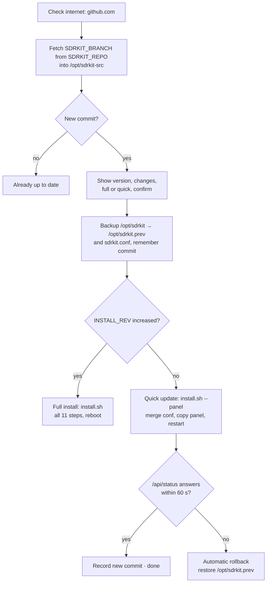

# Updating

SDR-Kit updates itself from GitHub, keeps your configuration and data, checks that the new version starts and **rolls back automatically** if it does not.

- [Before you start](#before-you-start)
- [Update from the panel](#update-from-the-panel)
- [Update from the command line](#update-from-the-command-line)
- [What is preserved](#what-is-preserved)
- [Quick update vs full update](#quick-update-vs-full-update)
- [Health check and automatic rollback](#health-check-and-automatic-rollback)
- [Manual rollback](#manual-rollback)
- [Testing a branch](#testing-a-branch)
- [Logs](#logs)

## Before you start

The Pi needs **internet access**: connect it to your home WiFi, or add your phone's hotspot as a known network (**More → WiFi**). In the field, on its own `SDR-Pi` hotspot, it cannot reach GitHub.

## Update from the panel

1. **More → System → Updates → 🔎 Check for updates.** The panel asks GitHub (up to 30 s) and shows the installed and new versions, the number of changes and the commit messages. If the new version needs packages, it says *Needs a full install*.
2. **⬇ Update now** and confirm. The updater runs in its own systemd unit (`sdrkit-update`), so it survives the panel restarting.
3. The card shows the live update log. When it ends with success the page reloads (about one minute for a quick update).

## New-version notices (optional)

The first time someone opens the panel, a short welcome tour explains what the kit does and asks whether to turn on
**new-version notices**. The choice is stored on the Pi and can be changed any time in **More → System → Updates →
Tell me when a new version is out**.

- **Off by default** (nothing is checked until the user says yes).
- When on, the panel checks GitHub only while the Pi is connected to a WiFi network as a client (your home WiFi, the
  one you use for SSH, or your phone's hotspot) — never on its own `SDR-Pi` hotspot: right after joining the WiFi and
  then every 6 hours (at most once every 10 minutes).
- The check is the same as **🔎 Check for updates** (`sdrkit update --check`): it fetches the public repository to read
  the version number and the commit messages. Nothing is uploaded; GitHub sees the Pi's IP address as with any web visit.
- If there is a new version, opening the panel shows a notice with the changes and two buttons: **⬇ Update now** or
  **Later** (asks again the next day). **Only the notice is automatic: the update always needs a tap.**
- The version next to **SDR-Kit** at the top shows the result: 🟢 up to date, 🟠 new version, ⚪ not checked. Tap it for
  the details and the last check time.

In demo mode set `SDRKIT_DEMO_LATEST=9.9.9` to pretend GitHub has a newer version.

## Update from the command line

```sh
sudo sdrkit update            # show the changes and ask before installing
sudo sdrkit update --check    # only report whether there is something new
sudo sdrkit update --yes      # install without asking
sudo sdrkit update --force    # reinstall even if already up to date
sdrkit version                # installed version, commit, repository and branch
```

The Spanish names (`actualizar`, `--buscar`, `--si`, `--forzar`) keep working.

> [!NOTE]
> `--check` works without `sudo`: it only asks GitHub whether there is a newer commit (without the list of changes). `sudo sdrkit update --check` also lists them.

## What is preserved

| Kept | Where |
|---|---|
| Your configuration | `/etc/sdrkit/sdrkit.conf` — new options of the new version are **appended** under a dated comment; existing values are never changed. A copy is saved as `/etc/sdrkit/sdrkit.conf.antes-de-actualizar` |
| Recordings, memories, activity, decoded messages, sensors, occupancy, alarms, calibration, panel state | `/var/lib/sdrkit/` |
| OpenWebRX+ settings | `/var/lib/openwebrx/settings.json` (band profiles are only seeded when no SDR is configured) |
| Browser preferences | Saved analyzer settings, language and tab live in each browser |

## How an update works



Updates are **commit-based**: any new commit on the tracked branch counts, whether or not `VERSION` changed. Only one update can run at a time (lock file `/run/sdrkit-update.lock`).

## Quick update vs full update

| | Quick update | Full update |
|---|---|---|
| When | `INSTALL_REV` in the new `install.sh` is **not** higher than the installed one | `INSTALL_REV` **increased** (new packages or system changes) |
| What runs | `install.sh --panel`: merge configuration, copy the panel to `/opt/sdrkit`, restart the `sdrkit` service | The complete installer, all [11 steps](installation.md#what-the-installer-does) |
| Duration | Seconds (about a minute including the check) | Like an installation; the Pi **reboots** at the end |
| Health check / auto-rollback | Yes | Yes — the Pi only reboots once the panel answers |
| Log | `/var/log/sdrkit-update.log` | `/var/log/sdrkit-update.log` + `/var/log/sdrkit-install.log` |

The installed install revision is stored in `/var/lib/sdrkit/install_rev`.

## Health check and automatic rollback

After a quick or full update the updater polls `http://127.0.0.1:<PANEL_PORT>/api/status` up to 30 times (3 s timeout, 2 s apart). A `200` or `401` (login required) counts as healthy; only then is the new commit recorded in `/var/lib/sdrkit/commit`.

If the copy fails or the panel does not answer within about 60 s, the updater:

1. restores `/opt/sdrkit.prev` to `/opt/sdrkit`,
2. reinstalls the matching `sdrkit` command,
3. resets `/opt/sdrkit-src` to the previous commit and restores the commit record,
4. restarts the panel and prints `↩` with the version it returned to.

## Manual rollback

```sh
sudo sdrkit rollback
```

This swaps `/opt/sdrkit` and `/opt/sdrkit.prev` (and the recorded commits) and restarts the panel. Running it **again** goes forward to the newer version. Only **one** previous version is kept: each update replaces `/opt/sdrkit.prev`.

> [!NOTE]
> Rollback restores the panel files only. Packages installed by a full update stay installed, and your configuration is not rewound (the pre-update copy is in `/etc/sdrkit/sdrkit.conf.antes-de-actualizar`).

## Testing a branch

To try changes before they reach `main`:

1. Push them to a branch, for example `pruebas`.
2. On the Pi, set `SDRKIT_BRANCH="pruebas"` with `sudo sdrkit config`.
3. `sudo sdrkit update`.

To return to the stable version, clear `SDRKIT_BRANCH` (empty means `main`) and update again. To follow a fork, set `SDRKIT_REPO` to its clone URL; when empty, the updater uses the origin of `/opt/sdrkit-src`, and finally the official repository `https://github.com/romartak/sdrkit.git`.

### Kits installed from the microSD

A kit installed with `/boot/firmware/sdrkit/install.sh` has no `/opt/sdrkit-src` yet. The first `sudo sdrkit update` clones the repository there (from `SDRKIT_REPO`, or the official repository when empty) and from then on updates like a GitHub install.

## Logs

| File | Contents |
|---|---|
| `/var/log/sdrkit-update.log` | Every update: versions, changes, health check, rollback |
| `/var/log/sdrkit-install.log` | Full installations (including full updates) |
| `sdrkit logs` | Live journal of `sdrkit`, `sdrkit-netwatch` and `openwebrx` |

Problems with updates are covered in [Troubleshooting → Updates](troubleshooting.md#updates).
