# User guide

A tour of every tab and card in the SDR-Kit panel. Each card also has an **ⓘ** button with a short in-panel explanation, and the **?** next to the logo opens a welcome sheet.

- [Getting around](#getting-around)
- [Analyzer](#analyzer)
- [Radio](#radio)
- [Decode](#decode)
- [Recordings](#recordings)
- [More](#more)
- [Language](#language)
- [Keyboard shortcuts](#keyboard-shortcuts)

## Getting around

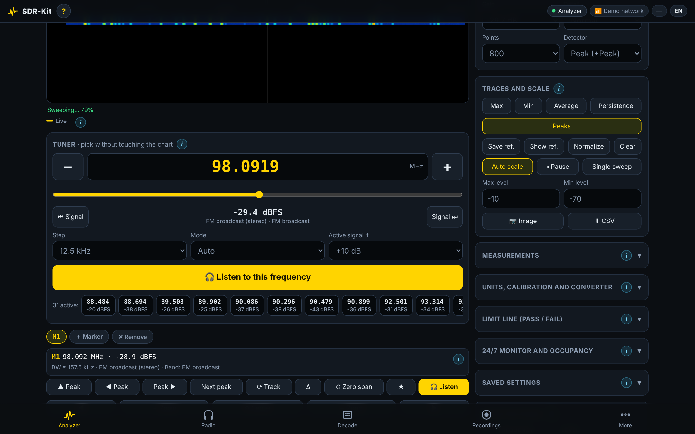

| Element | Meaning |
|---|---|
| **Tab bar** (bottom) | **Analyzer · Radio · Decode · Recordings · More**. The panel remembers the last tab |
| **● REC** chip | A recording is in progress |
| **⚡ Undervoltage** chip | The Pi's supply voltage is too low right now (see [Hardware → Power](hardware.md#power)) |
| **Mode** chip | Who owns the dongle: *Analyzer*, *Radio*, *Sensors*, *Aircraft*, *Advanced receiver* or *Idle* |
| **Network** chip | `📡 Hotspot · n` (clients connected) or `📶 <network name>` |
| **🌡** chip | CPU temperature |
| **EN / ES** chip | Switches the panel language ([Language](#language)) |
| **?** and **ⓘ** | Help sheets for the panel and for each card |

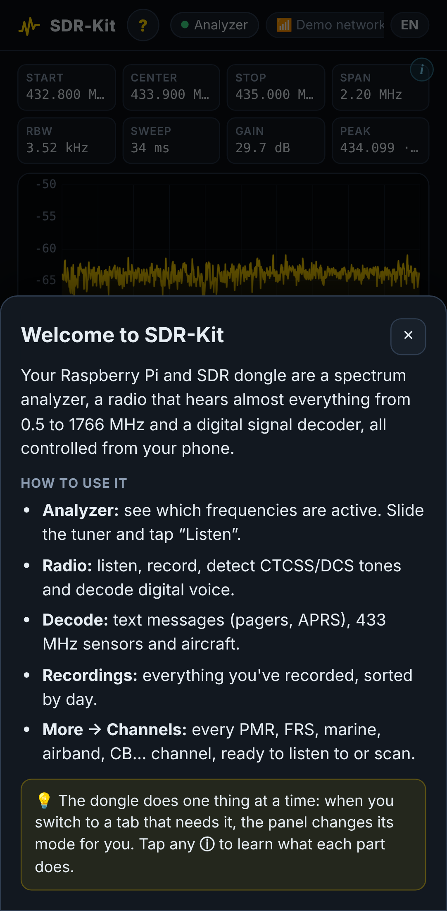

### One dongle, one job

The RTL-SDR can only do one thing at a time. The panel switches it automatically: pressing *Listen* in the analyzer moves the dongle to the Radio, starting the aircraft radar stops the analyzer, and so on. When a tab needs the dongle but another mode has it, the tab shows an overlay such as **Use the analyzer** or **Use the radio**; tap it to take the dongle back.

To save CPU and battery, the analyzer and the radio stop about **20 seconds after the last viewer leaves**, unless something must keep running: the [24/7 monitor](#247-monitor-and-occupancy), recording, the scanner or data decoders.

> [!TIP]
> Add the panel to your phone's home screen (**Add to Home Screen** in the browser menu). It then opens full-screen like an app.

## Analyzer

### Readouts, spectrum and waterfall

The top row shows **Start**, **Center**, **Stop**, **Span**, **RBW** (resolution bandwidth), **Sweep** (time per sweep), **Gain** and **Peak** (strongest signal on screen).

- The **spectrum** plots level against frequency; the **waterfall** below keeps the history, newest line on top, warm colours for strong signals.
- **Tap or drag** on either graph to move the active marker. **Double-tap** to zoom in (4×).
- The legend shows which traces are on: *Live*, *Max hold*, *Min hold*, *Average*, *Reference*, *Limit*.

What you are looking at:

| Shape | Usually |
|---|---|
| Stable narrow peak | A broadcast station or continuous carrier |
| Blob that comes and goes in the waterfall | Someone talking on a walkie-talkie or repeater |
| Wide, flat-topped block | Digital signal: TV, cellular, WiFi, DMR |
| Peaks everywhere | Overload: lower the gain |

### Tuner

The **Tuner** card under the waterfall lets you choose a frequency without touching the graph.

| Control | What it does |
|---|---|
| **− / +** | One step. **Hold** to keep stepping, faster and faster |
| **Frequency box** | Type the exact frequency in MHz. If it is off screen, the view moves there |
| **Slider** | Sweeps across everything on screen, step by step |
| **⏮ Signal / Signal ⏭** | Jump to the previous / next active signal. With none left on screen, the view moves |
| **Signal chips** | Every signal that stands out from the noise; tap one to go there |
| **Step** | 1 kHz to 1 MHz. 12.5 kHz walkie-talkies and repeaters · 25 kHz or 8.33 kHz airband · 100 kHz FM broadcast · 10 kHz (9 kHz in Europe) AM |
| **Mode** | *Auto* (by band), FM, Wide FM, WFM, AM, USB, LSB, Digital |
| **Active signal if** | How far above the noise a signal must be: +6, +10, +15, +20 or +30 dB |
| **🎧 Listen to this frequency** | Opens the Radio exactly there |

### Markers

Up to **4 markers** (M1–M4). The active one follows taps and the tuner; the chips above the marker bar select, add or delete markers.

| Button | Action |
|---|---|
| **▲ Peak** | Active marker to the highest peak |
| **◀ Peak / Peak ▶** | Nearest peak to the left / right |
| **Next peak** | Walks through the peaks from highest to lowest |
| **⟳ Track** | The marker follows its signal on every sweep |
| **Δ** | Shows frequency and level difference against M1 |
| **⏱ Zero span** | Opens [zero span](#zero-span) on the marker frequency |
| **★** | Saves the frequency to the Radio's memories |
| **🎧 Listen** | Opens the Radio on the marker |

Under the marker bar you see the occupied width, the probable signal type and the **band name** (for example *Marine VHF*, *ISM 433 MHz*). The **◀ · − Zoom · ⊙ Center · + Zoom · ▶** row pans and zooms the view.

### Sweep or zero span

The first card on the right switches between **📊 Sweep** and **⏱ Zero span**.

In **Sweep** mode:

- **Quick band** jumps to a preset range: FM broadcast, airband, ham 2 m and 70 cm, weather satellites, VHF/UHF services, marine VHF, pagers, radiosondes, ISM 433/868/915, PMR446, FRS/GMRS, digital TV, cellular 700/850/900, trunking 800, ADS-B, GPS L1, CB, AM medium wave, shortwave 49 m, full HF/VHF/UHF, and a full 24–1766 MHz sweep. HackRF presets (2.4 GHz WiFi, 5.8 GHz, 1–6000 MHz) appear only when the engine supports those frequencies.
- Or type **Start/Stop** or **Center/Span** and press **Apply**.

#### Zero span

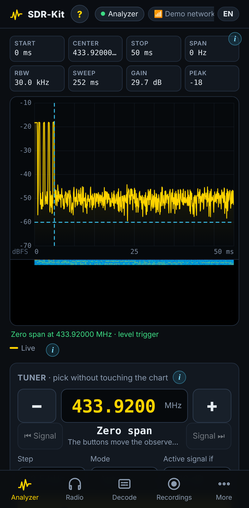

Zero span plots the power of **one frequency over time**, like an RF oscilloscope: remote-control bits, radar cadence, data bursts.

| Setting | Values |
|---|---|
| Frequency | Any frequency the dongle tunes |
| RBW | 1, 3, 10, 30, 100, 200 kHz |
| Time on screen | 2 ms to 2 s |
| Trigger | **Free run**, or **On level**: the trace freezes on the first sample above the **Trigger level** (10 % pre-trigger) |

> [!TIP]
> 50 ms with an *On level* trigger shows the bits of a 433.92 MHz gate remote or doorbell neatly aligned. Use the **Pulses** measurement to read pulse width, period and duty cycle.

Zero span needs the native RTL-SDR engine (not available with HackRF or `rtl_power`).

### Sweep receiver

| Setting | Meaning |
|---|---|
| **Gain** | Tuner gain in dB. Start at **29.7 dB**; lower it if peaks appear everywhere |
| **Detail** | *Fast*, *Normal* or *Fine*: more averaging and resolution, slower sweeps |
| **Points** | 400–2400 columns |
| **Detector** | **Peak** (+Peak: catches everything, best for searching), **Average (RMS)** (true power: use it for measurements), **Sample** |

### Traces and scale

| Button | What it does |
|---|---|
| **Max / Min / Average** | Max hold (catches short transmissions), min hold (real noise floor), running average |
| **Persistence** | Colour density of where the trace falls most often: reveals intermittent signals hidden in noise |
| **Peaks** | Labels the strongest peaks |
| **Save ref. / Show ref.** | Freezes a trace to compare before/after (with and without a filter…) |
| **Normalize** | Subtracts the reference: with a noise source this measures filters and antennas like a scalar analyzer |
| **Clear** | Resets the held traces |
| **Auto scale / Max level / Min level** | Vertical scale |
| **⏸ Pause / Single sweep** | Freeze the display / take one sweep |
| **📷 Image / ⬇ CSV** | PNG of spectrum + waterfall; CSV with live, max, min and average columns |

### Measurements

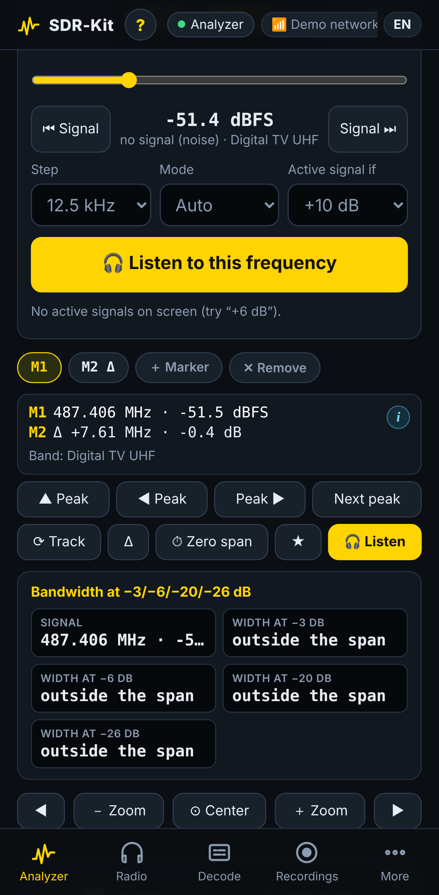

Choose a **Measurement**; the result appears under the spectrum. It uses the active marker (or the strongest signal).

| Measurement | Reports |
|---|---|
| **Channel power** | Total power inside a channel of the given **Channel width** |
| **Occupied bandwidth (OBW 99 %)** | Width that holds 99 % of the energy |
| **Bandwidth at −3/−6/−20/−26 dB** | Width at those levels below the peak |
| **Adjacent channel power (ACPR)** | Power spilling into the neighbouring channels at the given **Spacing**, in dBc |
| **SNR and noise density** | Signal-to-noise ratio and noise per Hz |
| **Frequency counter** | Exact carrier frequency (interpolated) |
| **Harmonics and THD** | 2nd–5th harmonics of a transmitter and total harmonic distortion; a button sets a span that shows them |
| **Pulses (zero span)** | Pulse width, period and duty cycle |

Channel presets: FM 12.5 kHz, FM 25 kHz, FM broadcast, TV 6 MHz, LoRa/LTE 1.4, WiFi 20 MHz.

> [!TIP]
> For accurate power readings use the **Average (RMS)** detector and zoom onto the signal.

### Units, calibration and converter

- **Units:** dBFS (relative), dBm, dBµV and dBmV (both for 50 Ω).
- **Calibrate:** feed a signal of known level (signal generator, or a friend's tinySA), put the marker on it, type its real level in dBm and press **Calibrate**. The correction is stored on the Pi together with the gain used; the panel warns if you change the gain afterwards. Expect ±2–3 dB: an RTL-SDR is not a lab instrument. **Delete calibration** returns to uncorrected values.
- **Converter (MHz):** offset added to every displayed frequency when you use an upconverter (`-125` for a 125 MHz HF upconverter) or an LNB (`9750`).

### Limit line (pass / fail)

Set an **Upper limit** and/or **Lower limit**; the display shows **PASS / FAIL** and can **Beep on fail**.

- **Limit = marker + 3 dB** sets the upper limit from the active marker.
- **Monitor on the Raspberry** copies the upper limit into the [24/7 monitor](#247-monitor-and-occupancy) as its alarm level and turns the monitor on, so the check keeps running with the panel closed. (Turn *Normalize* off first: the monitor uses absolute levels.)

### 24/7 monitor and occupancy

The Pi keeps sweeping the current range even when nobody has the panel open, logs how busy each frequency is and records alarms.

| Setting | Meaning |
|---|---|
| **Monitor even with the panel closed** | Turns the monitor on (the dongle switches to the analyzer) |
| **Alarm above** | Level, in the displayed units, that raises an alarm. Empty = no alarms |
| **Log every** | 10 s, 30 s, 1 min, 5 min or 15 min per occupancy row |
| **Only from / To (MHz)** | Restrict alarms to part of the range |
| **Phone alert (ntfy)** | Sends each alarm to your phone through [ntfy](https://ntfy.sh) |

- The **occupancy map** plots time (newest on top) against frequency, as **Occupancy %** (share of sweeps above the alarm level, or 10 dB above the median when no alarm level is set) or **Max level**. **⬇ CSV** exports it.
- Alarms are rate-limited to one every 30 s and listed under **Alarms**. They are also appended to `/var/lib/sdrkit/alarmas.jsonl`; occupancy rows to `/var/lib/sdrkit/ocupacion.jsonl`.

**Phone alerts:** set `NTFY_TOPIC` to a hard-to-guess name in `/etc/sdrkit/sdrkit.conf` (`sudo sdrkit config`), install the free **ntfy** app and subscribe to that topic. The Pi needs internet access. See [Configuration](configuration.md#phone-alerts-ntfy).

### Saved settings and detected peaks

- **Saved settings** stores the band, units, measurement, limits and visible traces under a name, **in this browser** (up to 40). Tap one to restore it.
- **Detected peaks** lists the strongest signals: tap a frequency to put the marker there, 🎧 to listen.

Without calibration, levels are relative (dBFS): good for comparing, not lab-grade dBm.

## Radio

### Frequency, modes and seek

- **Tap the frequency** to type it (0.1–1766 MHz). **− / +** move one step (hold to keep going); the step selector offers 1, 5, 6.25, 12.5, 25, 100 kHz and 1 MHz.
- **Modes:**

  | Mode | Use |
  |---|---|
  | **FM** | Walkie-talkies and repeaters (12.5 kHz channels) |
  | **Wide FM** | 25 kHz channels |
  | **WFM** | Broadcast FM (de-emphasis 75 µs in the Americas, 50 µs in Europe — `REGION`) |
  | **AM** | Airband, medium wave, CB |
  | **USB / LSB** | Amateur HF voice |
  | **Digital** | DMR, P25, D-Star, YSF, NXDN, dPMR, M17 — see [Digital voice](digital-voice.md) |

- **⏮ Seek signal / Seek signal ⏭** works like a car radio's seek: it scans up to 10 MHz down or up, in the current step, and stops on the first channel above the squelch.
- **▶ Listen on this phone** plays the audio in the browser (you can lock the screen). The **volume** slider goes to 200 %.

When the radio recognises a digital signal while you listen in FM, a banner such as *Digital signal detected: 4FSK 4800 baud…* appears with one-tap buttons to decode it (voice, POCSAG, FLEX or APRS).

### Signal and squelch

- The meter shows the channel level and the noise floor.
- Move the **squelch** slider just above the noise: audio opens only when a signal is present. **Auto** sets it to noise + 8 dB; **Open** disables it.
- **Gain**: as in the analyzer.

#### Fox-hunt mode

**🎯 Fox-hunt mode** opens a full-screen meter with a beep whose pitch and rate rise as the signal gets stronger. Walk and turn a directional antenna (a 3-element Yagi from the [antenna calculator](antennas.md#in-panel-calculator)) toward the maximum. **Reset max** clears the peak; if the value sticks at the top, lower the gain.

### Panorama

±96 kHz of spectrum and waterfall around the tuned frequency; the yellow band is the channel you are hearing. Tap it to jump to a nearby signal.

### Decoding: CTCSS, DCS and DTMF

In FM the radio measures, while someone talks:

| Field | Example | Notes |
|---|---|---|
| **CTCSS tone** | `88.5 Hz` | 50 standard tones (67.0–254.1 Hz). Shown after ~2 s, once two consecutive analyses agree |
| **DCS code** | `D023N ≡ D047I` | 104 standard codes, normal or inverted, with the equivalent code |
| **DTMF** | `*123#` | Keys dialled during the transmission |

This is what you would program into a radio to talk with that group — if you are licensed to transmit.

### Digital voice

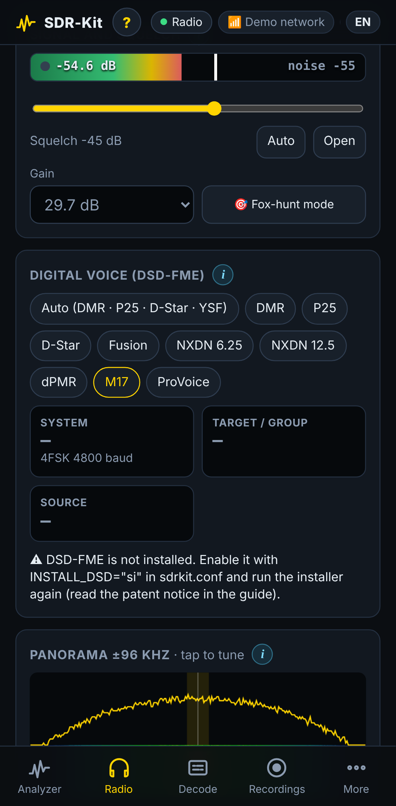

In **Digital** mode the **Digital voice (DSD-FME)** card appears: choose the system (*Auto* covers DMR, P25, D-Star and YSF; NXDN, dPMR, M17 and ProVoice must be selected) and read **System**, **Target / group** (with colour code or NAC) and **Source** (with talker alias). Encrypted calls are reported as such and stay silent. Full details: [Digital voice](digital-voice.md).

### Digital data on this frequency

Chips for **POCSAG, FLEX, APRS, EAS, Selcall, Morse, FMS** start multimon-ng on the current channel. Decoding works **even with the squelch closed and with nobody listening**; messages appear here and in [Decode → Messages](#messages). Data modes are received in FM.

### Record

- **⏺ Record now** records until you stop it.
- **Automatically record every transmission** creates one file per transmission (with 0.6 s of pre-roll), even with your phone locked or the panel closed.

### Instant replay

**⏪ What did they say?** plays back the last 30 seconds of what you heard — only audio with the squelch open, the silences
between transmissions are cut to a short pause — even if nothing was being recorded. While it plays the live audio pauses;
tap again to stop. **💾 Save** keeps exactly that clip as a recording (tagged **⏪ replay** in Recordings). The audio lives in
RAM and nothing is written to the card until you save. It only fills while the radio is running (panel open on Radio,
scanner, recording or data decoder active). Length: `REPLAY_SEC` (0 = off).

Recordings are 16-bit mono WAV at 24 kHz in `/var/lib/sdrkit/grabaciones/YYYY-MM-DD/`. Transmissions shorter than `REC_MIN_SEC` are discarded, the oldest files are deleted when the folder exceeds `REC_MAX_MB`, and recording does not start with less than 300 MB free on the card. See [Recordings](#recordings).

### Scanner

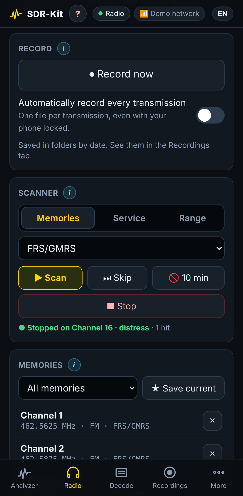

| Source | Scans |
|---|---|
| **Memories** | One memory group |
| **Service** | Every channel of a service from [More → Channels](#channels) (PMR446, FRS, marine, airband, CB…) |
| **Range** | From / To (MHz) with a step in kHz |

**▶ Scan** starts, **⏭ Skip** moves on, **🚫 10 min** ignores the current channel for 10 minutes, **■ Stop** ends. The scanner measures every channel within a ~780 kHz window from a single tuning, so a group of 22 channels is checked in about 40 ms. It stops where someone talks and resumes 2 s after the transmission ends. Up to 4000 channels; minimum step 1 kHz.

### Memories

- Favourite frequencies organised in groups. The first run creates groups for your region: FRS/GMRS or PMR446, marine VHF, airband, amateur radio, CB, NOAA weather (Americas) and an FM example.
- **★ Save current** stores the current frequency, mode and name.
- **⬇ Export / ⬆ Import** a JSON file (import can replace all memories or add to them).
- **📈 View in analyzer** shows ±1 MHz around the current frequency.

## Decode

### Messages

The **Digital messages (multimon-ng)** card:

1. Pick a preset in **What to listen to** (APRS Americas 144.390 / Europe 144.800 / ISS 145.825 / Japan–Australia, VHF pagers, 929–931 MHz pagers, 466 MHz pagers, NOAA EAS 162.550 / 162.400, Selcall/FMS, Morse) or type a frequency and modulation.
2. Choose the decoders (POCSAG, FLEX, APRS, EAS, Selcall, Morse, FMS).
3. Press **▶ Decode** (the dongle moves to the Radio). **🎧 Listen** opens the Radio; **■ Stop** turns the decoders off.

The **Received** list is searchable (text, RIC, callsign) and filterable by type; **⬇ CSV (Excel)** exports everything, **Delete** clears it. APRS stations with a position also appear on the [aircraft radar](#aircraft).

### Sensors

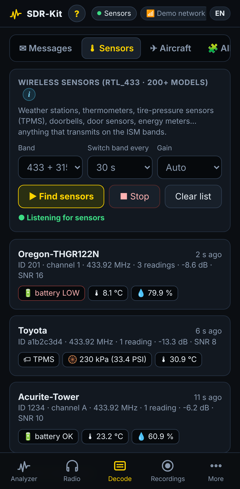

**Wireless sensors (rtl_433 · 200+ models)**: weather stations, thermometers, tyre-pressure sensors (TPMS), doorbells, door sensors, utility meters.

| Setting | Values |
|---|---|
| **Band** | `433`, `315`, `868`, `915`, `345`, `433+868`, `433+315`, `433+915` MHz (default `433+315` in the Americas, `433+868` in Europe) |
| **Switch band every** | 15 s to 2 min, when two bands are selected |
| **Gain** | Auto or fixed |

**▶ Find sensors** starts rtl_433. Each device becomes a card with its readings (temperature, humidity, pressure, battery…) and the **Latest readings** table lists every packet. In a residential area devices show up within minutes; TPMS sensors of passing cars within seconds.

### Aircraft

**Aircraft radar (ADS-B 1090 MHz) · no internet**, powered by dump1090.

- **▶ Start radar**; aircraft appear within 10–60 s. **Range**: 50, 100, 200 or 400 km.
- The table shows flight, altitude, speed, heading, distance and bearing. **Emergency squawks are drawn in red**: 7700 (emergency), 7600 (radio failure), 7500 (unlawful interference).
- **Your location (radar center):** type latitude and longitude in decimal degrees, or set `RECEIVER_LAT`/`RECEIVER_LON`. **📍 Phone GPS** only works on `https` pages, which the panel does not use, so typing the coordinates is the reliable way. Without a location the radar centres on the aircraft received.
- **Show decoded APRS stations** overlays APRS positions from the Messages decoder.

Antenna: a vertical quarter-wave of **6.5–6.9 cm**, as high as possible. Typical range is 100–250 km with a clear view. See [Antennas](antennas.md).

### Ships (AIS 162 MHz)

**Ship map · no internet**, with the same look as the aircraft radar.

- **▶ Start map**; ships appear within 1–5 minutes (each one transmits every few seconds to a few minutes, depending on its speed). **Range**: 10, 25, 50, 100 or 200 km.
- The map is centred on your location, the same one you save under **Aircraft → Your location**. Ships are colored by type (green cargo, orange tanker, light blue passenger, violet fishing, yellow tug) and leave a trail. Squares are aids to navigation and base stations.
- The table shows name, MMSI, type, size, speed, course, destination (or navigation status) and distance. **Distress beacons are drawn in red**: AIS-SART, man-overboard and EPIRB (MMSI 970/972/974…) or navigation status 14.
- Needs a decoder: `sudo apt install rtl-ais` or [AIS-catcher](https://github.com/jvde-github/AIS-catcher). The installer adds them when your repository has them. SDR-Kit decodes the NMEA sentences itself.
- The dongle works on 162 MHz while the map is on, so the analyzer and the radio pause (as with the aircraft radar). AIS is a public, short-range signal: only ships that transmit appear, typically 20–60 km from the coast with a vertical antenna of about 46 cm.
- *Not verified with real hardware yet:* tested against real AIS sentences and in demo mode; the options passed to `AIS-catcher` / `rtl_ais` still need a check on a Pi.

### All modes

**Everything this device can decode** lists every decoder with its installation status: those that run **in this panel** (multimon-ng modes, CTCSS/DCS/DTMF, digital voice, the digital-signal identifier, rtl_433, dump1090, AIS) and those available **in the advanced receiver** (OpenWebRX+): RDS, ACARS, VDL2, HFDL, UAT 978, radiosondes, LoRa/Meshtastic, FT8 family (with `INSTALL_WSJTX`), JS8, RTTY, PSK31, NAVTEX, SSTV, FAX, DRM, DAB+, HD Radio, TETRA, FreeDV, M17 and AMBE digital voice (with a licensed dongle). Tap an entry to jump to it. The same list is available over SSH with `sdrkit decoders`.

## Recordings

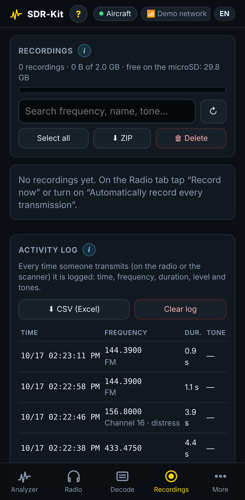

- The header shows how many recordings there are, the space used against `REC_MAX_MB`, and the free space on the card.
- Recordings are grouped by day, with time, frequency, mode, duration and badges (*auto*/*manual*, CTCSS, DCS, DTMF). Search by frequency, name or tone.
- ▶ plays, ⬇ downloads; select several (or **Select all**) for **⬇ ZIP** or **🗑 Delete**.
- The **Business panel** (above the activity log) charts the log: transmissions per hour and per day, airtime, the busiest channels and the longest transmission, for today, 7 or 30 days.
- The **Activity log** records every transmission the radio or scanner detects, even when nothing is recorded: time, frequency, duration, peak level, tones and digital type. **⬇ CSV (Excel)** exports it; 🎧 returns to that frequency.

Over SSH, `sdrkit recs` shows the folder, the number of files and how to copy them to a PC with `scp`.

## More

### Channels

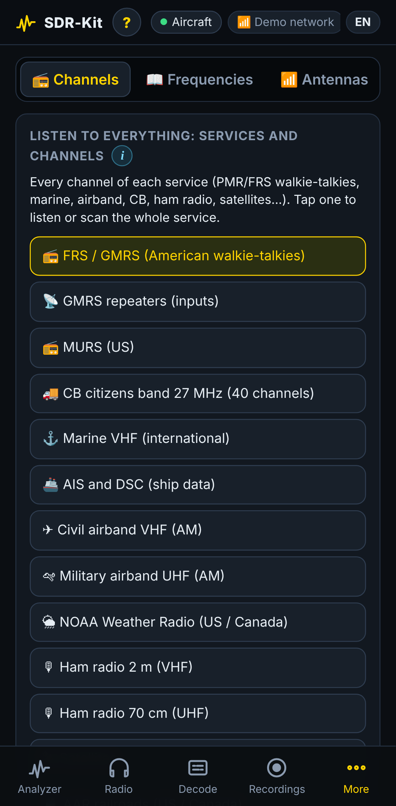

Complete channel plans. Tap a service to see what it is and who uses it; tap a channel to listen, **📡 Scan** to scan the whole service (or its full band), **★ Save as group** to copy it to your memories, **📈 View in the analyzer** to see it. Services of the other region appear dimmed.

| Service | Channels / range |
|---|---|
| PMR446 (Europe) | 16 analogue channels |
| dPMR446 / DMR446 | 32 digital channels (6.25 kHz) |
| FRS / GMRS (Americas) | 22 channels + GMRS repeater inputs |
| MURS (USA) | 5 channels |
| LPD433 (Europe) | 69 channels |
| CB 27 MHz | 40 channels (AM) |
| Marine VHF | All international channels (duplex channels on the coast-station frequency) |
| AIS / DSC | Ship data channels |
| Civil airband VHF | Key frequencies + the whole 118–137 MHz band |
| Military airband UHF | 243.0 MHz + the 225–400 MHz band |
| NOAA Weather Radio | 7 channels |
| Amateur 2 m and 70 cm | Calling, APRS, ISS, DMR, M17 + full bands |
| Satellites | NOAA APT, Meteor LRPT, ISS, SO-50 |
| AAR railroad (USA/Canada) | 160.215–161.565 MHz |
| VHF / UHF services | 148–174 and 450–470 MHz |
| 800 MHz trunking / P25 | 851–869 MHz (P25 on a fixed channel; no trunk following) |
| Pagers | 929–932 MHz and VHF/UHF frequencies |
| FM, AM broadcast, shortwave | Full bands |

### Frequencies

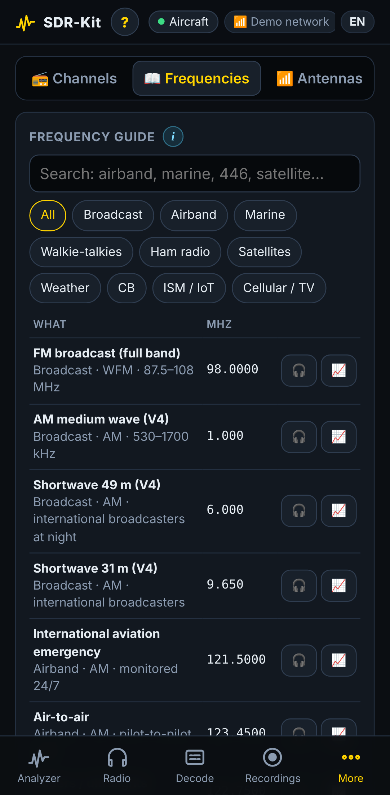

A searchable **Frequency guide** by category (radio, airband, marine, walkie-talkies, amateur radio, satellites, weather, CB, ISM/IoT, cellular/TV), filtered by your `REGION`. 🎧 opens the radio, 📈 shows it in the analyzer. Below it: the **50 standard CTCSS tones** and the **104 DCS codes** with their inverted equivalents. Frequencies vary by country — confirm them locally.

### Antennas

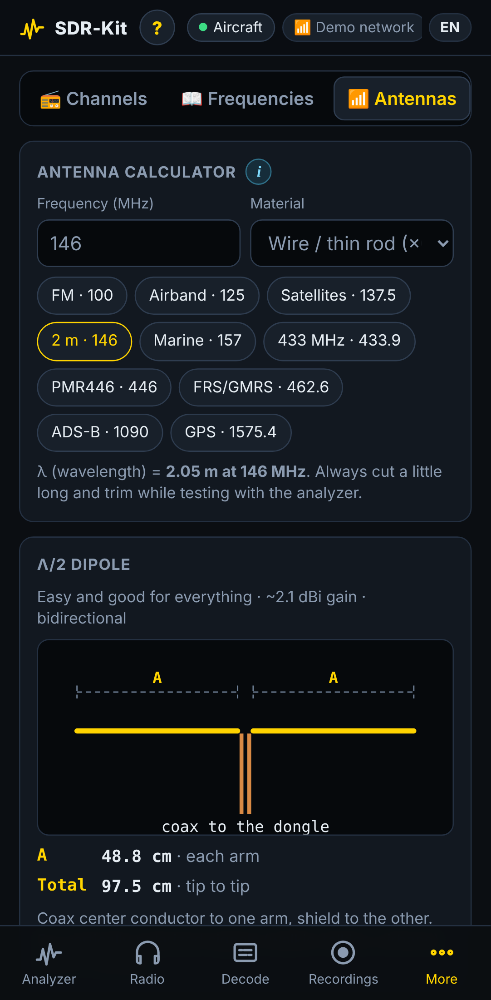

Dimensioned drawings for dipole, ground-plane, J-pole, 3-element Yagi, satellite V-dipole, discone and telescopic whip at any frequency, a **Coax cable loss** calculator and a **Which antenna for what?** table. See [Antennas](antennas.md).

### Advanced receiver

**📡 Open advanced receiver** starts **OpenWebRX+** (it takes a few seconds; the panel waits up to 2 minutes) and opens it on port **8073**. It offers a large waterfall and dozens of decoders, with ready-made band profiles: FM broadcast in 2 MHz slices, airband, 2 m, marine, ISM 433/70 cm, FRS/GMRS or PMR446, ADS-B and, with an RTL-SDR Blog V3/V4, medium wave, 49 m shortwave and CB.

- Opening it **pauses the analyzer and the radio**: the dongle has one owner at a time. Coming back to the panel and choosing another function stops OpenWebRX+.
- Opening it on a specific frequency adds a band profile tuned there, named *📍 Desde el analizador* ("from the analyzer"). The band profiles written into OpenWebRX+ use Spanish names.
- **OpenWebRX+ settings (admin user)** opens `http://<pi>:8073/settings`; the `admin` password is the panel password.
- Up to 3 simultaneous listeners.

### WiFi

- The status card shows whether the Pi is a client of a known network or running its own hotspot, with the number of connected devices.
- **📡 Use own hotspot** forces the hotspot; **🏠 Find known WiFi** returns to automatic mode.
- **Saved networks**: connect or forget.
- **Add WiFi network**: type the SSID (or **Scan** — not possible while in hotspot mode), the password (8–63 characters, empty for open networks), mark **Hidden network** if needed, then **Save** or **Save and connect**.

> [!NOTE]
> Changing networks disconnects your phone from the Pi. Join the new network and reopen the panel; if the Pi cannot connect, the hotspot comes back on its own.

### System

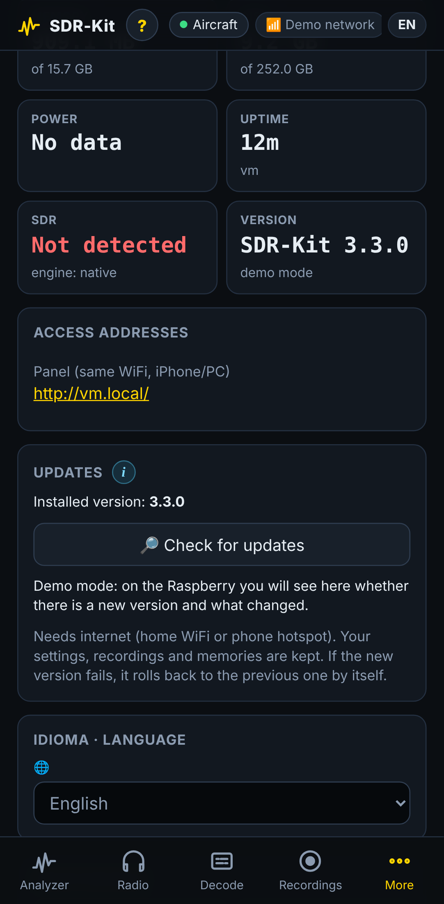

- **Tiles:** temperature (red above 75 °C), CPU and load, memory, disk, power (undervoltage now or since boot), uptime, detected SDR and analyzer engine, version.
- **Access addresses:** `http://<hostname>.local`, and the panel and advanced-receiver URLs for every IP, including Tailscale.
- **Updates:** **🔎 Check for updates**, then **⬇ Update now**. **Tell me when a new version is out** turns on the
  optional new-version notices (checked only while the Pi is on your WiFi; nothing is installed without a tap). The
  version and its dot (🟢 up to date, 🟠 new version, ⚪ not checked) are always at the top next to **SDR-Kit**. See
  [Updating](updating.md#new-version-notices-optional).
- **About SDR-Kit:** link to the GitHub repository (a ⭐ helps the project) and the **🗺 Roadmap** (what is coming, with its status), **★ Rate**
  (stars kept only on your device), **📤 Share** (share sheet, WhatsApp, Telegram, X, Facebook, email, copy link) and
  **👋 Introduction** to see the welcome tour again.
- **Language:** English / Español.
- **Maintenance:** **📄 View logs** (last 200 lines of the SDR-Kit services), **🔄 Restart** (reboots the Pi), **⏻ Shut down**, **Log out** (shown only when a password is set).

> [!WARNING]
> Shut down from here before unplugging the battery and wait until the green LED stops blinking (about 20 s). This protects the microSD.

## Language

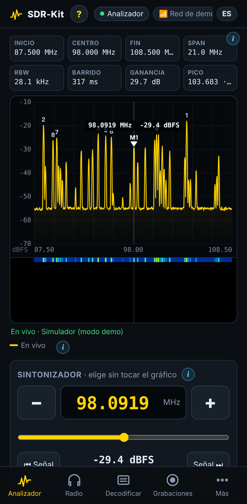

The panel speaks **English** and **Spanish**.

- On the first visit it follows the browser language: Spanish for `es-*` browsers, English otherwise.
- Switch with the **EN/ES** chip in the header or **More → System → Language**. The page reloads in the new language.
- The choice is stored **per browser** (key `sdrkit.lang` in local storage), so each phone keeps its own.
- Adding `?lang=en` or `?lang=es` to the URL forces a language and remembers it; the login page follows the same setting.

The installer and the `sdrkit` command use `SDRKIT_LANG` (see [Configuration](configuration.md#general)).

## Keyboard shortcuts

On a computer, in the Analyzer tab (when no input field has focus):

| Keys | Action |
|---|---|
| **← / →** | Tuner one step down / up |
| **Alt + ← / →** | Ten steps |
| **Shift + ← / →** | Previous / next active signal |
| **Enter** | Listen to the tuner frequency |
| **Esc** | Close a help sheet |
